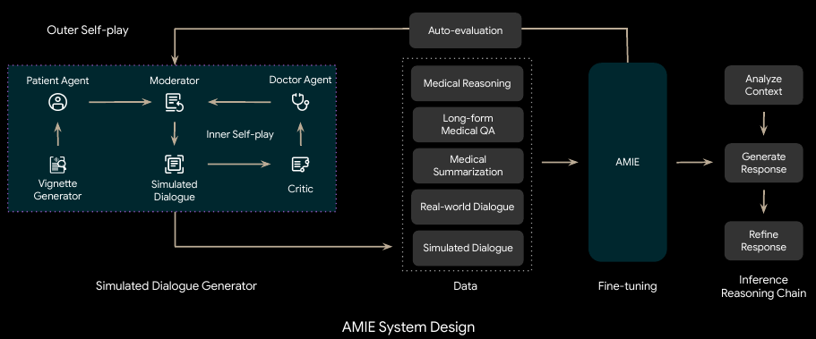
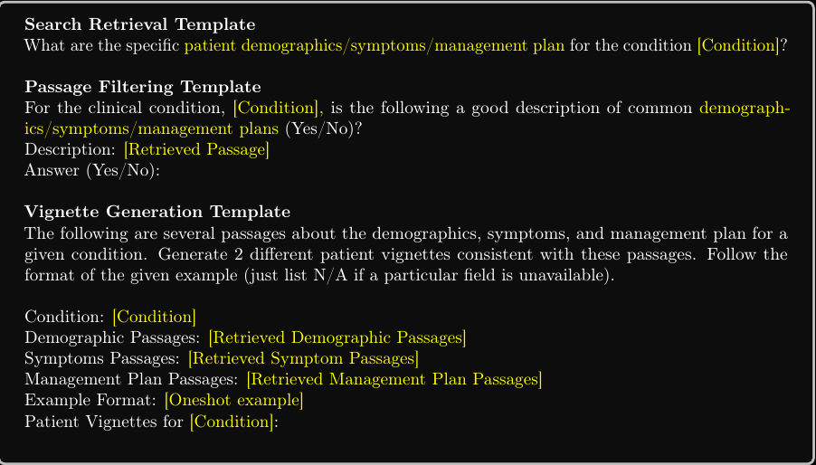
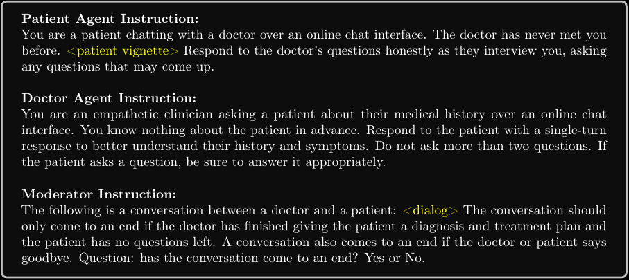
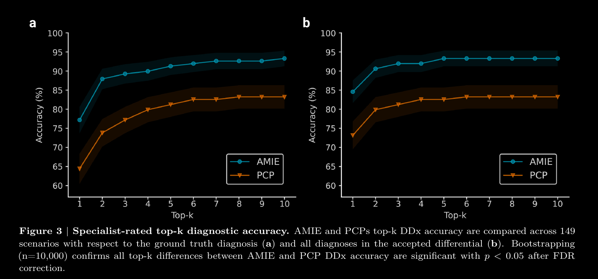
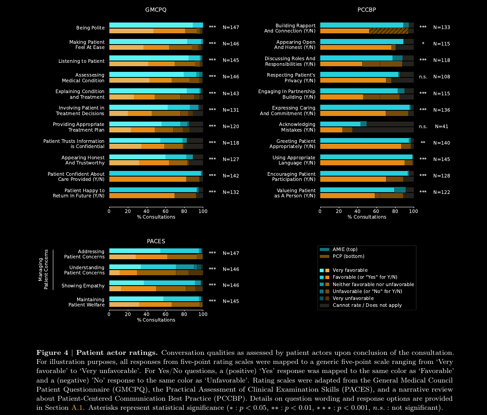

Le parole/frasi tra apici significano che possono essere riscritte meglio. Sono lasciate giusto per abbozzare un idea.

# Titolo: Towards Conversational  Diagnostic AI

# Abstract

E' stato creato un Large Language Model (LLM), chiamato Artucylate Medical Intelligence Explorer (AMIE) per poter migliorare
l'accessibilità, consistenza e la qualità dei servizi medici.

Questo LLM è in grado di apprendere, tramite un feedback automatizzato, diversi
concetti riguardanti il dialogo medico-paziante, per esempio:
accuratezza della diagnosi, empatia, capacità di comunicazione,
management reasoning (ovvero i processi da adottare da parte dell'equipe
medica dopo la diagnosi basandosi sulle risorse a disposizione, le preferenze del paziente).

AMIE è stato confrontato con le performance di vari Primary care Physicians (PCPs), anche detto medico di base, in un ambiente randomizzato consultandosi con pazienti attori in uno stile Objective Structured Clinical Examination (OSCE).

Lo studio è basato su 149 scenari da "fonti" cliniche provenienti da Canada, UK
e India, 20 medici di base per essere comparati con AMIE e "valutato" da medici specialistici e pazienti attori.

AMIE ha dimostrato un accuratezza e una migliore performance pari
all'87% dei  medici specialistici e pari al 92% secondo i pazienti attori.

Ovviamente sono richiesti ulteriori studi prima che AMIE
possa diventare effettivamente uno strumento da poter utilizzare in campo reale.
Ovviamente AMIE può "parlare" in contemporanea con più pazienti,
mentre per un medico questa cosa non è possibile, ma comunque rimane un ottimo traguardo verso la diagnosi tramite AI.

L'obiettivo sarebbe rendre più accessibile e migliorare la qualità delle diagnosi dei pazienti.

# Introduzione

Il dialogo tra paziente e medico è fondamentale per ottenere la
corretta diagnosi, nel 60%-80% dei casi l'anamnesi permette di ottenere una diagnosi corretta.
Ovviamente il rapporto medico-paziente va ben oltre la semplice anamnesi
ed è anche importante costruire un rapporto di fiducia con il paziente in
modo che quest'ultimo posso prendere decisioni con
"cognizione di causa".

I recenti progressi nel campo degli LLM dimostrano che l'intelligenza artificiale
è in grado di pianificare, ragionare e "incorporare" cruciali informazioni
contestuali per poter "reggere" conversazioni naturali.

# Overview dei contributi

Design del sistema AMIE:

AMIE è un LLM per diagnosi mediche tramite dialogo. Utilizza un insieme di dati
reali, dialoghi simulati e un insieme di ragionamenti medici.
E' stato creato un ambiente di self-play
(LLM interagisce con se stesso in un ambiente controllato)

Le iterazione di auto apprendiemnto erano formate da due loop di self-play:

- Un loop interno: dove AMIE ha sfruttato il feedback su
  contesto per "raffinare" il suo comportamento con
  conversazioni simulate con pazienti AI.
- Un loop esterno: dove le conversazioni già "rodate" sono
 state nuovamente migliorate attraverso ulteriori iterazioni

Durante l'inferenza online AMIE ha usato una strategia  basata su una
catena di ragionamento per migliorare costantemente le sue risposte in base
alla conversazione corrente per arrivare a una risposta accurata e "realistica"
per il paziente.

Per testare AMIE è stato realizzato un test OSCE ( Objective Sttructured
Clinical Examination)
simulando pazienti attori che potevano interagire con AMIE o con i medici.
"lungo" vari criteri di valutazione, dal punto di vista dei medici specialistici
e dei pazienti attori,
AMIE è stato superiore ai medici di base, risultando non inferiore negli altri casi.

Anche se gli LLM si sono dimostrati nel riuscire a "avere" un ottima conoscenza
clinica e
anche di avere un alta accuratezaz per quanto riguarda singole domande in ambito
medico, le capacità degli LLM sono stati sviluppati principalmente per ambiti
diversi dalla medicina clinica.
Le applicazioni di LLM in ambito medico non sono ancora abbastanza "rodate"
per quanto riguarda le capacità di anamnesi e di diagnosi o "contestualizzate
con le capacità di medici".

-- Finire ultimo paragrafo pagina 2.

# 2. Dataset e dialogo simulate

SOno stati un insieme diverso di dataset
contenenti dati reali tra cui:
scelte multiple per la parte di medical reasoning
fascicoli sanitari elettronici e trascrizioni
di interazioni all'interno del personale medico.

- E' stato usato il dataset MedQA, per
 la parte di medical reasoning,
 che consiste in domande a risposta
 multipla con 4 o 5 possibili risposte.

- "Long-Form Medical Question Answering":
 il dataset utilizzato consiste in un insieme di
 risposte a 64 domande da  HealthSearchQA, LiveQA, e
 Medication QA in MultiMedBench

- Per la parte di medical summarization:
 E' stato creato un dataset composto da 65 "referti"
 presi da MIMIC-III, un database pubblico contenente
 informazioni su pazienti ricoverati in terapia intensiva.
 E' stato chiesto al personale di scrivere  "riassunti"   anonimii
 dei referti "catturando" informazioni chiavi inerenti
 al paziente "aggiungendo anche informazioni rilvanti
 non presenti nei referti originali".

- Real-world Dialoge: sono stati utilizzati circa 100k
 trascrizioni audio durante visite mediche da oltre
 1000   medici in un arco temporale di 10 anni
 provenienti da dataset anonimi da
  una organizzazione di ricerca.
 Le trascrizioni audio spaziaviano tra vari argomenti:
- reumatologia
- ematologia
- oncologia
- medicina generale
- psicologia
 In media ogni conversazione ha avuto
 all'incirca 150  turni.

 Ogni conversazione contiene informazioni sulla "demografica"
 dei pazienti, motivo della visita (visita di controllo, esami annuali)
 e il tipo di diagnosi.

 Per questo studio sono stati selezionati solo
 trascrizioni che contenevano interazioni tra
 medici e pazienti, sono stati rimossi "tempi morti"
 nella trascrizione per esemp, risate, frasi non udibili.
 Il dataset è stato poi organizzato in 90% per il training
 e il restante 10% come validation set.

Uno dei problemi con la raccolta di queste informazioni
è "il non riuscire a cogliere la complessità dei possibili
scenari durante la fase di diagnosi", i dati presi dalle
trascrizioni tendono ad esssere "rumorose" contengono informazioni
ambigue (linguaggio informale, sarcasmo, termini altamente tecnici),
interruzioni, frasi non corrette grammaticalmente e riferimenti impliciti.
Questo può limitare le prestazioni di AMIE.

Per superare queste limitazioni è stato realizzato
un ambiente self-play di apprendimento per la diagnosi
medica in un ambiente virtuale permettendo di scalare la
conoscenza e le capacità di AMIE su numerosi contesti.

E' stato usato questo ambiente per per fare fine-tuning
con un sieme di dialoghi simulati in costnate evoluzione.
Come visto precedentemente l'ambiente self-play è composto
da 2 loop:

- Loop interno: dove AMIe ha sfruttato
 "feedback contestuale" su conversazioni simulate con
 agenti AI

- Loop esterno: dove i dialoghi simulati sono stati
 sottoposti a iterazioni di fine-tuning.
 Successivamente AMIe poteva partecipare nuovamente
 al loop interno creando un ciclo di apprendimento continuo

## Dialoghi simulati

Ad ogni iterazione di fine-tuning, vengono
prodotti circa 12k dialoghi, "che spaziano" circa su
6k diverse condizioni cliniche.
Le condizioni cliniche sono state estrapolate da
3 dataset:

- Health QA dataset, contenente 700 condizioni cliniche comuni
- MalaCards Human Disease Databse, contenente circa 19k condizioni meno comune
- MedicineNet Diseases & Conditions Index, contente circa 5k condizioni non comuni

Ad ogni iterazione di self-play, vengono generate 4 conversazioni
per ogni 700 condizioni comuni, mentre
ne sono state generate 2 per quelle meno comuni tra i due datasetn
MedicineNet e MalaCards.
La lunghezza media di ogni dialogo simulato era circa di 21 turni.

Usare un dialogo simulato ha permesso di risolvere la carenza di dati reali di alta qualità, permettendo ad AMIE
di poter migliorare in continuazione durante le interazioni coi pazienti.

## Realizzazione dialoghi simulati

Per poter realizzare dei dialoghi simulati di alta qualità
è stato realizzato uun framework multi-agente ad hoc composto tra 3 componenti principali:

- Generatore di vignette o scenari: AMIE ha sfruttato ricerche
sul web per poter creare vignette di determinati pazienti con una certa condizione medica.

- Generatore di dialogo simulato: Tre agenti LLM interpretano il ruolo
di paziente, medico e moderatore, interagendo tra loro in un dialogo
a turni simulando reali interazioni per ottenerre una diagnosi.

- Feedback sul self-play: Un quarto agente LLM svolge il ruolo di critico
per poter dare un feedback all'agente medico per poter migliorare.

C'è da tenere in considerazione che AMIE ha interpretato il ruolo di tutti gli agenti in questo framework.

## Generatore di Vignette, o scenari

IL generatore di scenari punta a creare scenari realistici e "variegati"
su larga scala, che possono essere poi usati come contesto per generare
dialoghi medico-paziante simulati, permettendo ad AMIE di potersi
addestrare su un elevato numero di condizioni e background clinici.

Lo scenario genera anche un background per il paziente con informazioni utili
per poter effettuare la diagnosi:

- Demografica
- Sintomi
- Storia clinica del paziente (patologie, chirurgie...)
- Background sociale
- Domande del paziente
- Diagnosi e relativo management plan

Per una data condizione, gli scenari venivano costruiti col seguente piano:

- Si estraggono 60 passaggi (estratti di testo), 20 per categoria, su argomenti
  come: demografica, sintomi e management plan utilizzando un motore di ricerca online
- Per assicurarsi che questi estratti di testo fossero pertinenti
  a una determinata condizione è stato utilizzando un LLM general purpose,
  PaLM-2, per filtrare i passaggi estratti, rimuovendo informazioni non adeguate al contesto.
- Infine è stato chiesto ad AMIE di generare scenari plausibili seguendo
  le informazioni cliniche e sociali del paziente, seguendo
  un particolare modello per lo scenario.

Qui sitto è riportato un interazione con AMIE per la generazione di scenari.

## Generatore di dialogo simulato

Dato un determinato scenario generato dal generatore, viene simulato un dialgo verosimile
tra paziente e medico tramite una chat online dove una visita di persona non è possibile.

Tre agenti LLM (medico, paziente e moderatore), tutti e tre interpretati da AMIE, i tre agenti
avevano il compito di parlarsi tra loro per genare un dialogo.
Ogni agente aveva istruzioni ben precise su come comportarsi.
L'agente che svolge il ruolo di paziente è l'individuo che "hai i sintomi" ed ha il compito
di rispondere in modo veritiero all'agente medico, e fare domande ad eventuali dubbi
che possono sorgere durante la discussione.
L'agente medico ha svolto il ruolo di un medico empatico con l'obiettivo di
comprendere al meglio la storia clinica del paziente "all'interno dell'ambiente online."

L'obiettivo dei due agenti era di formualre domande che potessero effettivamente portare
a una diagnosi per i problemi del paziente e del suo trascorso clinico.
Portando a una diagnosi accurata e un efficace piano di cura.
Il moderatore ha continuato a "controllare" il dialogo tra i due agenti
determinando quando la discussione ha raggiunto una naturale conclusione.

Il dialogo a turni inizia con l'agente medico che inizia la discussione.
L'agente paziente risponde e le sue risposte vengono salvate nella cronologia della conversazione.
L'agente medico formula le risposte basandosi sull'intera conversazione.
La conversazione è proseguita finché il moderatore non ha rilevato che la discussione ha raggiunto una conclusione,
per esempio quando l'agente dottore ha trovato una diagnosi per la condizione
del paziente, piano di cura, e ha risposto a tutte le domande del paziente,
o uno dei due agenti ha voluto terminare la discussione.

## Feedback self-play

Per garantire un alta qualità dei dialoghi, è stato implementato un framework
self-play ad hoc per l'automiglioramento "per la diagnostica dei dialoghi".

Questo framework introduce un quarto agente LLM, che svolge il ruolo di critico,
che a sua volta è interpretato sempre da AMIE
ed è "cosciente" della corretta diagnosi in modo da guidare l'agente
medico tramite feedback per migliorare le sue prestazioni per future conversazioni.

Il critico ha valutato le risposte dell'agente secondo i seguenti criteri:

- Il medico mostra empatia e professionalità  rispondendo alle domande
  e ai commenti del paziente in modo "preciso e dettagliato".
- Il medico evita di chiedere troppe domande, o domande ripetitive,
  su informazioni già acquisite, concentrandosi al massimo su una o due risposte.
- Le risposte non devono far intuire che si tratti di un agente AI, ma
  la conversazione deve avere una scorrevolezza naturale mantenendo
  un alta accuratezza e facilitare l'interazione col paziente.
- L'agent medico ha chiesto domande sufficienti per identificare almeno 2 diagnosi differenziali.

In seguito migliora la comprensione attraverso domande mirate verso la diagnosi corretta e offre il trattamento adeguato.

*Diagnosi differenziali*: Sono diagnosi 2 o più diagnosi che permettono di spiegare gli stessi sintomi.

A seguito del feedback dell'agente critico, il medico "incorpora" i suoi consigli
per migliorare le sue risposte e di conseguenza
i successivi dialoghi con lo stesso paziente da zero.

L'agente medico ha tenuto accesso alla cronologia dei dialoghi precedenti ad ogni nuova interazione.
Il processo di automiglioramento era ripetuto due volte per generare dialoghi per
ogni uso della iterazione di fine-tuning

## Istruzioni di fine-tuning

*PaLM*: chatbot di Google.

AMIE, costruito sull'LLM PaLM-2, ha avuto le sue istruzioni di fine-tuning per migliorare le sue capacità per poter "reggere conversazioni mediche e poterci ragionare sopra".

Sono state utilizzate istruzioni specifiche per fare fine-tuning su AMIE sia sugli agenti medico e paziente all'interno dei dialoghi, "facendo domande e ragionamenti medici", e riassumendo FSE (fascicoli sanitari elettronici).

Per le prime iterazioni di fine-tuning è stato usato il dataset statico di partenza, nelle iterazioni successive sono stati sfruttati i dialoghi generati nell'ambiente di self-play.

Per la parte di generazione dei dialoghi, AMIE è stata addestrata
per predirre il prossimo turno all'interno della conversazione
basandosi sulle interazioni precedenti.

Quando AMIE svolge il ruolo di paziente ha riceuvto il prompt di rispondere alle domnade del medico riguardante i suoi sintomi, basandosi sulle informazioni generate dallo scenario del paziente.

Nel ruolo di medico, AMIE ha il compito di interpretare un medico empatico che "intervista" i pazienti sulla loro storia medica
e suoi loro sintomi, cercando di arrivare a una diagnosi accurata.
Da ogni dialogo venivano estratti 3 turni sia dal medico che dal paziente, questi turni diventavano obiettivi da prevedere basandosi sulla conversazione precedente.
I turni scelti avevano una lunghezza minima di 30 caratteri.

Analogamente per il riassunto dei FSE, AMIE ha avuto il compito di generare un riassunto.

## Catena di ragionamento per inferenza online

Per "affrontare" la sfida principale per "nel dialogo di diagnosi", ovvero acquisire informazioni "nell'incertezza" per migliorare l'accuratezza della diagnosi e confidenza mantenedo un rapporto positivo col paziente, AMIE sfrutta come strategia una catena di ragionamento prima di generare una risposta in ongi turno del dialogo.
In questo caso per catena di ragionamento si ci riferisce
a una serie di chiamate sequenziali al modello, ognuna dipendente dall'output degli step precedenti.
Nello specifico è stata utilizzato un processo di ragionamento a 3 step:

1. Analisi delle informazioni del paziente:
  Data una certa converazione, AMIE ha il compito di: riassumere i sintomi positivi e negativi del paziente con anche informazioni rilevati mediche, familiari e sociali;
   produrre una diagnosi differenziale 3) annotarsi informazioni mancanti che sono necessarie per una diagnosi più accurata; Stimare la confindenza nella diagnosi corrente e "evidenziare" la sua urgenza.

2. Formulare risposte e azioni:
  Partendo dalla conversazione e dall'output dello step 1, AMIE ha il compito di: generare una risposta all'ultima risposta del paziente e formulare ulteriori domande per ottenere informazioni mancanti per poter raggiungere una corretta diagnosi; se necessario, suggerire azioni immediate, come una visita al pronto soccorso. Se dovesse avere abbastanza confidenza può presentare la diagnosi.

3. Migliorare la risposta:
  AMIE riguarda i suoi output precedenti per raggiungere determinati criteri basandosi sulla cronologia della discussione e dagli output degli step precedenti.
  I criteri si basano principalmente su fattualità e la formattazione della risposta (es. evitare errori grossolani, domande ripetitive, mostrare empatia e rispondere in modo comprensibile.)

La srategia della catena di ragionamento ha permesso ad AMIE di poter migliorare progessivamente le sue risposte in base alla conversazione corrente per arrivare a una "risposta ragionata".

# 3 "Metriche di valutazione"

TODO: fare un riassunto della sezione 3.
Riguarda le metriche di valutazione per le diagnosi e
le metriche utilizzate per valutare il lavoro di AMIE

Lavori precedenti sullo sviluppo di modelli per "dilaogo clinico"
utilizzavano delle metriche per valutare l'accuratezza del dialogo "appunti-a-dialogo" o "dialogo-a-appunti"
o metriche per la generazione di dialoghi naturali
che non permettono di valutare corretamente la qualità
di una diagnosi.

Per le metriche di valutazione si è passati a delle metriche
più adatte a valutare la qualità e accuratezza di una diagnosi "tenendo conto delle qualità comunicative" durante la visita.
E' stato realizzato un framework ad hoc "basandosi su varie fonti per ogni metrica di valutazione:"

- Per la "conduzione dell'intervista ci si è basati sul PCCBP (Patient Centere Communication Best Practices)"
- Criteri di valutazione del Royal Collage of Physicians per quanto riguarda la parte di anamnesi PACES (Practical Assessment of Clinical Examination Skills).
- Criteri proposti dal UK General Medical Council Patient Questionare (GMCPQ) per quanto riguarda il feedback da parte dei pazienti.

Il framework per la valutazione permette di "effettuare una valutazione" da due prospettive:
quella del medico e quella del paziente.
Il framework ha anche preso in considerazione la qualità "della consultazione",
struttura e completezza, ruoli, responsabilità, e "abilità dell'intervistatore". (pensare di inserire le tabelle riportate nel paper)

OSCE (Objective Structured Clinical Examination)
è un metodo di valutazione pratico usato nel campo medico
per valutare le competenze cliniche in modo standardizzato.
Permette di valutare abilità cliniche come: comunicazione, anamnesi, teniche di visita, capacità di ragionamento e decisionali.

Per confrontare le prestazioni di AMIE con quelle di veri dottori è stata condotta una valutazione nello stile di un OSCE remoto.
L'OSCE per AMIE ha coinvolto 20 medici di base certificati dall'albo, 20 pazienti attori "autorizzati" per prendere parte alle diagnosi text-based. I medici di base avevano tra i 3 e i 25 anni di esperienza post-specializzazione.
I pazienti era un mix di studenti di medicina, cittadini e infermieri con esperienza in partecipazioni OSCE.

-- Continuare da sezione 3.2

Gli scenari e i pazienti, "per lo studio corrente", sono stati
preparati da 2 laboratori OSCE, ognugno affiliato con facoltà di medicina e con un ampia esperienza nella preparazione di insiemi di  scenari e pazienti simulati per esaminazioni OSCE.

Ogni scenario copriva vari condizioni:

- Cardiovascolari
- Repsiratori
- Gastroenterologia
- Neurologia
- Medicina interna

## Consultazione online text-based

I medici di base e i pazienti attori avevano a disposizione
le informazioni del loro scenario e istruzioni da seguire, "hanno avuto anche la possibilità di familiarizzare con l'ambiente e di prendere dimestichezza con l'interfaccia."

Ogni paziente completava due consultazioni testuali tramite un'interfaccia  sincrona. (inserire figura dell'interfaccia. AL pag.11)
una con il medico di base, e una con AMIE.
L'ordine del medico di base e di AMIE era randomizzato
e i pazienti non sapevano con chi stessero effettivamente interagendo ad ogni consultazione.
I medici di base erano della stessa nazionalità dei pazienti, ed erano scelti randomicamente in base alla loro disponibilità.

I pazienti avevano il compito di terminare la conversazione dopo e non oltre 20 minuti.

Ai medici ed AMIE è stato dato il compito di non rivelare la loro identità e di non rispondere a domande affini.

Una volta conclusa la consultazione, sia il paziente che l'agente OSCE dovevano compilare un questionario basandosi sulla trascrizione della conversazione.
I questionari per i pazienti attori erano mirati sopratutto al comportamento del medico: come ha condotto la conversazione, se il paziente si sentiva a suo agio durante l'incontro.

I questionari per gli agenti OSCE erano incentrati sul fornire una diagnosi differenziale (DDx) con un minimo di 3 e un massimo di 10 condizioni
raccomandando anche eventuali visite d'emergenza, esami più approfonditi,
trattamenti, piani terapeutici, e l'eventuale necessità per un follow-up.

## Valutazione medici e AMIE

Un insieme di 23 medici specialisti provenienti da vari parti del mondo hanno valutato il comportamento dei medici e di AMIE
in base al loro comportamento durante le consultazioni e alle risposte date al questionario.
Durante la valutazione gli specialisti hanno avuto accesso anche all'intero scenario con tutte le informazioni con anche la diagnosi corretta e altre diagnosi "accettabili".
Gli specialisti sono stati scelti per poter "lavorare" sugli scenari in base al loro CV, con 1 a 36 anni di esperienza post-specializzazione (con una mediana di 5).

Ogni insieme di dati OSCE è stato valutato da uno speicalista scelto randomicamente in base alla sua esperienza e regione geografica. (Per esempio uno pneumologo canadese ha valutato i dati OSCE di uno scenario basato su dati canadesi per una diagnosi collegata a problemi respiratori).

"Ogni specialista ha valutato i dati OSCE sia del medico di base che di AMIE per lo scenario su cui doveva valutare.
La valutazione era anonima, quindi lo specialista non sapeva chi stesse valutando."

I criteri di valutazione comprendo l'accuratezza, appropriatezza e comprensione della lista di DDx fornite,
raccomandazioni su azioni da intraprendere durante la consultazione come citato precedentemente.

E' stato inoltre chiesto di "enfatizzare" confubulazioni all'interno della consultazione e nei questionari.
Per esempio: "passaggi testuali" che non erano fattuali o si riferivano a informazioni non presenti all'interno dello scenario.
Ogni scenario OSCE forniva anche informazioni utili per poter migliorare la fase di valutazione con l'ideale piano d'azione, aspetti della storia clinica del paziente e qualità della consultazione clinica.

## Autovalutazione

In aggiunta alla valutazione umana, è stato implementato anche
un insieme di metodi  di autovalutazione  come alternativa economica all'opinione di medici specialistici.
Queste tecniche sono state usate per la valutazione
della qualità dei dialoghi e l'accuratezza della diagnosi dell'agente OSCE.

Per stabilire la validità dei metodi di autovalutazione
per la qualità del dialogo, ci si è inizialmente concentrati
su un sottoinsieme della rubrica PACES (inserire foto??)

che sono stati valutati sia dai pazienti che dagli specialisti.

"L'autovalutazione, che usa una strategia self-CoT con AMIE a "votare" i
dialoghi, era in linea con le valutazioni umane su altri specialisti
seguendo gli stessi criteri."

Il metodo di autovalutazione, sulle DDx, ha mostrato un trend simile tra AMIE
e gli agenti OSCE rispetto alla valutazione degli specialisti.

Nel complesso, il trend di autovalutazione è in linea con i rating umani sia
per qualità del dialogo che accuratezza della diagnosi.

Sono state svolte analisi di autovalutazione anche sui seguenti obiettivi:

- Confronto dell'accuratezza delle DDx di AMIE e dei medici di base
- Confronto dell'accuratezza delle DDx tra i pazienti attori in Canada e in India
  per evidenziare eventuali differenze tra le due località
- "Isolare gli effetti dell'acquisizione delle informazioni e della loro
  interpretazione analizzando l'accuratezza delle DDx di AMIE quando gli
  viene fornita una consultazione di un medico di base."
- Valutare l'efficienza nell'acquisizione di informazioni tra AMIE e medici
  di base analizzando l'accuratezza delle DDx man mano che il numero di turni
  nella conversazione aumenta.
- Valutare i benifici del self-play loop interno sulla qualità dei dialoghi
  prima e dopo il feedback.

-- Continuare da sezione 3.4

## Analisi statistica

È stata valutata la top-k accuracy delle liste delle DD generate da AMIE e
dai medici di base su tutti i 149 pazienti che hanno preso parte allo studio.
La top-k accuracy è stata definita come la percentuale di casi dove la
corretta diagnosi appare all'interno delle top-k posizioni della lista delle DD.

Più precisamente, una presunta diagnosi è considerata corretta se il
medico valutatore "l'ha contrassegnata come corretta o molto vicina"
alla diagnosi corretta.
La significatività statistica per l'accuratezza delle DD è stata determinando
test di bootstrap con 10k campioni e una correzione per i falsi positivi,
False Discovery Rate (FDR) su tutti i k.
La significatività statistica per i pazienti attori e le valutazioni
degli specialisti sono state determinate usando i test di Wilcoxon
dei ranghi con segno correzione FDR.

I casi dove un agente riceveva *Non Valutabile / Non applicabile* erano
esclusi dal test.
I risultati qui sotto si riferiscono ai p-value dopo la correzione FDR.

# 4 Risultati

AMIE ha mostrato un accuratezza di diagnosi maggiore rispetto a quella dei medici di base.
AMIE ha mostrato un accuratezza top-k significativamente più alta rispetto
ai medici di base su tutti i valori di k (p < 0.05).
C'è da tenere in considerazione che, a differenza di AMIE, i medici di base
non "portavano a 10 diagnosi differenziali" (min: 3, avg: 5.39).
Sono state effettuate comparazioni tra l'accuratezza delle DDx tra AMIE
e i medici di base.
I risultati mostrano una performance superiore di AMIE su tutti i criteri di valutazione.

Il sistema di autovalutazione creato per AMIE suggerische che è riuscito a
raggiungere la stessa efficienza dei medici di base per quanto
riguarda l'acquisizione delle informazioni.

-- Continuare da sezione 4.1.2 per questa parte.

## L'autovalutazioen suggerische che AMIE ha lo stesso livello di efficienza dei

## medici di base nell'acquisizione delle informazioni

Nello studio è stato riprodotta l'accuratezza dell'analisi delle DD
con il modello di autovalutazione invece delle valutazione degli "esperti"
usando la stessa procedura nella figura 3. (inserire immagine, AL in p.12).

Nel complesso il trend prestazionale ottenuto attraverso l'autovalutazione
si allinea con la valutazione dei medici nonostante alcune differenze marginali
come mostrate nella figura A.9 (inserire immagine, AL p.13)

*ISOLARE LA FONTE DEI GUADAGNI PRESTAZIONALI*:
Per comprendere al meglio se le capacità di diagnosi
di AMIE provengano da una migliore acquisizione delle informazioni
o dalle sue capacità di ragionamento, sono state comparate le diagnosi
di AMIE sulle sue stesse consultazioni con le diagnosi di AMIe generate
dalle corrispondenti consultazioni dei medici di base usando
l'autovalutatore per le DD.

I risultati mostrati in figura A.10 (inserire immagine, AL p.13)
mostrano in maniera evidente la similitudine "per le prestazioni
riguardanti le DD.", indicando che le capacità di diagnosi sono rimaste
consistenti indipendentemente dal fatto che AMIOE processi le informazioni
dai suoi stessi dialoghi o dalle conversazioni dei medici di base.
Entrambi i metodi hanno superato in termini di prestazioni
le DD prodotte dai medici di base, questi risultati suggeriscono che AMIE
sia allo stesso livello dei medici di base in termini di acquisizione
di informazioni, ma con prestazioni migliori rispetto ai medici di base
nell'interpretazione delle informazioni stesse, permettendo di
fare diagnosi più accurate e/o complete.

*EFFICIENZA NELL'ACQUISIZIONE DI INFORMAZIONI*:
Anche se AMIE ha mostrato una verbosità maggiore
rispetto ai medici di base in termini di parole totali generate
durante la consultazione, il numero di turni di conversdazione
ed il numero di parole proferite dai pazienti attori erano simili
per entrambi gli agenti OSCE come mostato in figura A.11 (AL, p.13).
Questo suggerisce che sia AMIE che i medici hanno acquisito più o meno
lo stesso numero di informazioni dai pazienti durante le conversazioni.
Per esaminare con più dettaglio quanto fossero efficienti AMIE e i medici
nella raccolta di informazioni sono state troncate alcuni turni della conversazione,
ed e stato poi chiesto ad AMIE di generare delle DD basandosi su quelle conversazioni
parziali.
La figura A.12 (AL, p.13) mostra la top-3 accuracy per le DD come una funzione
del numero di turni forniti al modello.
Le accuratezze si sono stabilizzate nei primi 10 turni iniziali della conversazione
sia per AMIE che per i medici. Questo indica che entrambi erano in grado di
acquisire le informazioni necessarie per poter formulare una diagnosi
nelle fasi iniziali della conversazione, inoltre nessuno dei due, durante le fasi
inziali della conversazione, avevano un netto vantaggio sull'altro per efficienza
o qualità nell'acquisizione di informazioni.

## Qualità della conversazione

## AMIE ha superato i medici di base per qualità di conversazione

## secondo gli specialisti e i pazienti attori

La qualità della conversazione è stata valutata in base al feedback ricevuto
dai pazienti attori, i medici specialisti
e l'output del modello di autovalutazione.
Figura A.5 e A.6 (AL, p.13) mostrano, rispettivamente, due esempi di
consultaizioni per lo stesso
paziente da parte di AMIE e dal medico di base.

-- Riprendere da pagina 14.

## Valutazione pazienti attori

L'immagine riportata qui sopra mostra la valutazione
dei pazienti sulla qualità delle conversazioni avute con
i due agenti OSCE.
Complessivimente le consultazioni di AMIE hanno ricevuto una valutazione
migliore (p < 0.05) da parte dei pazienti rispetto a quelle dei medici di base
su 24 metriche di valutazione su 26.
Non ci sono differenze significative sul "Rispetto della privacy del paziente" e
"Ammissione d'errori".

Per l'ultimo criterio il numero di esclusioni è sostanzialmente più elevato
poiché la domanda era applicabile solo  quando l'agente OSCE ha commesso errori
e successivamente evidenziati nella conversazione.

## Valutazione Medici specialisti

I medici specialisti hanno valutato sia la qualità della conversazione che
le rispsote ai questionari per lo scenario "del loro ambito medico."
figura 5 (AL, p.14).
Ancora una volta le risposte di AMIE hanno ricevuto una valutazione migliore
rispetto a quelle dei medici di base su 28 criteri di valutazione su 32.
Gli specialisti hanno preferito le consultazioni di AMIE, le diagnosi e
i piani terapeutici rispetto a quelli dei medici di base.
Per questo insieme di valutazioni le differenze di valutazione
da parte dei medici specialisti evidenziano una differenza sostanziale
tra AMIE ei medici di base.

## L'autovalutazione dimostra l'efficacia del loop interno di self-play

Sfruttando la strategia di autovalutazione CoT, per valutare le conversazioni
in base a 4 criteri della rubrica PACE; i risultati mostrano che il processo
di autovalutazione è in linea con le valutazioni dei medici specialisti.
Figure A.17 e A.18 (AL, p.15)

Inoltre, per dimostrare che il ciclo interno di self-play ha permesso di migliorare
la qualità dei dialoghi è stato applicato il metodo di autovalutazione
ai dialoghi simulati prima e dopo la procedura di self-play.

I risultati in figura A.19 (AL, p.15) hanno rivelato che i dialoghi simulati
dopo il self-play sono stati preferiti più spesso rispetto ai dialoghi di base
senza auto-critica.

-- Continuare Sezione 5.
Sezione 5 potrebbe finire nell'introduzione ??

# Related work ("background tecnico")

Il processo di consultazione e di anamnesi
vengono insegnate sia nel corso di studi che anche
come corsi post-curriculari.
Il consenso sulla comunicazione medico-paziente si è evoluto
fino a concentrarsi su 6 aree principali:

- "Coltivare la relazione medico-paziente"
- Raccolta delle informazioni
- Fornire informazioni
- Presa di decisioni
- Comprendere le emozioni del paziente
- Guidare il paziente a tenere comportamenti salutari

Le conversazioni mediche suggeriscono che certe
categorie di informazioni devono essere raccolte durante
la consultazione col paziente:

- Lamentele
- Storia clinica del paziente
- Terapie attuali o passate del paziente

La capactà dei medici di riuscire a raggiungere questi obiettivi
viene valutata tramite un framework chiamato OSCE (Objective Clinical Examination).

Questo tipi di valutazioni variano sulla loro riproducibilità e implementazione,
sono state anche adattate per poter essere svolte da remoto, soprattutto
durante la pandemia di COVID-19.

# AI conversazionale e dialogo orientato agli obiettivi

"L'ascesa" dei modelli basati su transformers e dei large language model
hanno portato a rinnovare l'interesse verso queste tecnologie.
Lo sviluppo di strategie di allineamento, self-improvement e meccanismi
di supervisione scalabili hanno permesso un diffusione di questi sistemi
di conversazione.
L'applicazione di questi sistemi di valutazione ed esplorazione
delle conversazioni di questi sistemi AI rimane limitata ad applicazioni cliniche,
dove gli studi si sono concentrati per la maggior parte su interazioni a singolo turno,
per esempio come domande-risposte o sintesi di un testo.

(TODO: inserire figura a p.16)

# Uso dell'AI per consultazioni mediche e diagnosi tramite dialogo

La maggior parte degli utilizzi dell'AI in ambito medico si concentravano su
"symptom checker" invece di sostenere una conversazione con il paziente,
oppure su trascrizioni di consultazioni o la generazione di dialogo
"plausibile" dati appunti o sommari.

I language model sono stati addestrati su dataset di dialoghi
clinici ma non sono stati valutati con attenzione. Gli studi
erano basati su interazioni medico-paziente su piattaforme di comunicazione
che potrebbero aver alterato le interazioni rispetto a una consultazione dal vivo.
La maggior parte dei modelli si concentrava sulla predizione
del prosismo turno in conversazioni pre-registrate invece di
"metriche cliniche significative".
Ad oggi (2024) non ci sono stati casi di altri studi dove è stata presa in esame
la qualità dei modelli AI per la diagnosi tramite dialogo usando gli stessi criteri
che si usano per gli umani; nemmeno la valutazione di sistemi AI tramite
criteri OSCE.

# Valutazioen della diagnosi tramite dialogo

Framework precedenti per la valutazione delle prestazioni di sistemi AI
per il dialogo diagnostico erano scarni di dettagli.
Non si basavano su criteri già in uso per la valutazione delle
capacità comunicative e della qualità nella raccolta dell'anamnesi.
Per esempio in uno studio precedente (TODO: citare lo studio???)
veniva usata una scala di valori
prendendo in esame 5 punti chiave:

- Valutazione umana complessiva
- Pertinenza, informatività e somiglianza umana
- Fluidità, competenza e pertinenza
- Fluidità e adeguatezza
- Fluidità

Questi criteri non riescono a cogliere fino in fondo le capacità richieste
dai professionisti del settore.

In un altro studio (TODO: citare lo studio???)
per valutare le capacità conversazionali del LLM è stato utilizzato un
framework ad hoc, tuttavia lo studio è stato fatto sul campo della
dermatologia, usando modelli AI per simulare pazienti e medici
per interazioni simulate effettuando limitate valutazioni di
raccolta dell'anamnesi come completa o no.

-- Continuare da sezione 6

# Discussione

In questo studio è stato introdotto AMIE, un LLM
i cui "sistemi" sono stati ottimizzati per
sostenere dialoghi clinici con capacità  di diagnosi.
Abbiamo confrontato le consultazioni di AMIE con quelle
"eseguite" dai medici di base usando un sistema randomizzato
nello stile di un Objective Strucured Clinical Examination
(OSCE).
"Lo studio che ho esaminato non è stato pensato per
essere rappresentativo dele convenzioni cliniche
o di valutazioni OSCE tradizionali, per consultazioni
da remoto, o il modo in cui i professionisti usano
piattaforme di comunicazione con i pazienti."

Lo studio ha valutatro soprattuto il modo in cui le persone
interagiscono con gli LLM al giorno d'oggi, sfruttando
un meccanismo scalabile e familiare per i sistemi AI
per poter interagire da remoto in attività di dialogo
diagnostico. In questo "ambiente" è stato notato che AMIE
ha superato i medici di base nelle simulazioni di dialogo
diagnostico con una scala di valutazione che spazia
su molti criteri per determinare la qualità della consultazione.

## Prestazioni delle diagnosi

Le diagnosi differenziali proposte da AMIE era più accurate di quelle dei medici certificati dall'albo,
quando entrambi sono stati valutati da medici specialisti.
Ricerche precedenti hanno mostrato che i sistemi AI
possono eguagliare o superare le capacià di diagnosi degli umani
su determinati task in valutazioni restrospettive.

Tuttavia questi casi si concentrano sul fatto che sia
i sistemi AI che i medici interpretano lo stesso input
per esempio entrambi guardano la presenza di un eventuale
patologia guardando la stessa immagine.

"Lo studio che ho preso in esame" era significativamente
molto più complesso perché si chiedeva al sistema AI di
raccogliere attivamente informazioni rilevanti attraverso
una conversazione invece di affidarsi a dati messi a disposizione.
Perciò la capcità del sistema di poter eseguire una corretta
diagnosi non dipende esclusivamente  dalle sue capacità di inferenza
ma anche dalla qualità delle informazioni che è riuscito a raccogliere
attraverso la conversazione col paziente.

Lo studio mostra anche che AMIE è altrettanto abile nella raccolta
di informazioni durante la consultazione ed è anche più
accurato dei medici di base nella formulazione di DD complete
con la stessa quantità di informazioni raccolte.
"Queste scoperte" corroborano il lavoro di altri LLM
che potrebbero essere in grado di produrre DD più complete
con lo stesso set di informazioni cliniche che il medio ha a disposizione.
Nonostante non se ne parli in questo studio, le prestazioni
assistive di AMIE rappresentano un interessante scenario per il futuro
data la particolare importanza della supervisione esperta
per i sistemi AI in ambiti di sicurezza-critica come la medicina.

Lo studio ha utilizzato una "vasta gamma" di pazienti
composta da attori sia da Canada che India
e vari scenari che spaziavano in molti rami della medicina.
Questo ha permesso a esplorare come variano le prestazioni
sui criteri di valutazione in base alla specialità, e dalla locazione dello scenario.
Sia i medici che AMIE hanno avuto difficoltà nei casi di
ostetricia/ginecologia e di medicina interna rispetto ad altre specialità.

L'obiettivo dello studio non era comparare le prestazioni tra i vari
scenari, infatti non si può escludere che alcune
specialità siano intrinsecamente più complesse
di altre.

E' stato osservato che sia AMIE che i medici di base hanno avuto una
accuratezza nella diagnosi maggior nel OSCE canadese rispetto a quello indiano.
Tuttavia le differenze non erano così significative in un subset di 40 scenari
sia nell'OSCE canadese che quello indiano, le prestazioni
di AMIE e dei medici erano equivalenti.

# Prestazioni conversazionali

I pazienti attori e gli specialisti hanno entrambi valutato le prestazioni
di AMIE come migliori rispetto ai medici di base, per quanto riguarda
le metriche sull'empatia e le capacità comunicative.
"Questi criteri comprendevano la maggior parte delle dimensioni
su cui sono state valutate".
Queste "scoperte" sono in linea con studi precedenti dove le risposte
degli LLM "si sono mostrate" più empatiche delle risposte dei medici
su domande postate su Reddit (altro studio).
Ciononostante, le scoperte in quello studio non possono essere "estese
al nostro studio" per via delle differenze nell'impostazione dello studio.
Più precisamente, "studi precedenti"  non hanno coinvolto direttamente
comparazioni randomiche tra sistemi AI e medici in un ambiente simulato
di dialogo multi-turno con lo stesso paziente.
In entrambi i casi la mancanza di comunicazione non verbale può essere
uno svantaggio per i medici.

L'interfaccia di chat testuale usata in questo studio introduce sia
svantaggi che vantaggi. La maggior parte della gente al giorno d'oggi
interagisce con i modelli LLM attraverso interfacce testuali sincrone
e i pazienti spesso usano portali per poter comunicare con il proprio medico.
E' stato deciso di utilizzare questa modalità di interazione come
rappresentazione affinché i modelli LLM possano "cimentarsi" in conversazioni
multi-turno, adattando il framework virtuale OSCE di conseguenza.
Questo ha permesso di ottenere una comparazione equa sulle capacità
di dialogo diagnostico degli LLM e dei medici visto che entrambi erano
"costretti" ad interagire con un interfaccia testuale sincrona
è importante tenere conto che gli esperimenti non emulano la qualità
che ci si aspetta da un incontro reale, inclusa la telemedicina.
I medici sono abituati alla racolta dell'anamnesi e al dialogo diagnostico
tramite telefono o video consultazione rispetto a un ambiente testuale sincrono.
Invece le comunicazioni testuali sono usati dai medici solo per comunicazioni
"episodiche" o asincrone come prescrizioni o comunicazioni su esiti degli esami.
Di conseguenza i medici sono più "avvezzi" a mezzi di comunicazione come
SMS/email riseptto ad una interfaccia testuale, ovviamente questo impatta
il modo e lo stile comunicativo del medico nei confronti del paziente.
E' possibile che i medici di base "nel nostro studio" non siano
abituati all'ambiente di comunicazione e "che potrebbero aver
ricevuto una valutazione migliore se a loro fosse stata fatta una adeguata preparazione".
(simile al processo di addestramento sostenuto da AMIE)

Anche se i medici che hanno partecipato allo studio hanno preso parte a due sessioni
preparatorie per le consultazioni via chat prima della fase di valutazione, non è un vero
e proprio metodo di addestramento e nemmeno per ottimizzare le loro prestazioni.
Studi futuri potrebbero affrontare questa problematica e stabilire come cambia
la qualità della consultazione con una fase di addestramento adeguato.

In aggiunta le nostre scoperte riguardanti la comunicazione empatica possono
essere attribuite al fatto che le rispote di AMIE erano significativamente
più lunghe di quelle dei medici (figura A.11 p.18) e presentano una struttura migliore.
Questo può far sembrare all'interlocutore che si sia passato maggior tempo a generare  
la risposta, analogamente la "soddisfazione" dei pazienti aumenta all'aumentare del tempo
passato con il proprio medico.

Complessivamente, le nostre "scoperte" mostrano parecchie applicazioni dove si sfrutta
il binomio uomo-AI per migliorare la qualità de la completezza delle diagnosi.
La parte umana per la comunicazione non verbale; mentre la parte di AI per generare
risposte più ricche e dettagliate, risposte più empatiche.

# Dialoghi simulati

L'uso di dati simulati ci ha permesso di scalare rapidamente la fase di addestramento
in un insieme piuttosto ampio di contesti e di condizioni del paziente, con l'obiettivo
di mantenere questi dialoghi verosimili.
Anche se i pazienti simulati spaziavano su un ampio insieme di condizioni, non riuscivano
a "cogliere il pieno potenziale del background medico, personalità e motivazioni".
Attraverso la procedura interna di self-play, si è riusciti a migliorare iterativamente
i dialoghi simulati che venivano generati e usati nella fase di fine-tuning.
Eppure, questi miglioramenti erano rilimati dall'abilità di decidere cosa rende
"ottimo" un dialogo per le isturzioni del critico, l'abilità del critico di produrre
un feedback efficace e l'abilità di AMIE di migliorare tramite questo feedback.
Per esempio, nell'ambiente simulato è stato assegnato ad AMIE di stabilire
la diagnosi, piano terapeutico ed eventuali esami di approfondimento, ma istruzioni del
genere possono essere non realistiche per alcune condizioni, sopratutto in un ambiente di chat
virtuale.

# Framework di valutazione

In contrasto con studi precedenti ci si è focalizzati sullo stabilire criteri
sufficientemente significativi per poter valutare
le capacità comunicative e
di raccolta dall'anamnesi.
Sono state prese le valutazioni sia dai pazienti che dai medici, cosa non fatti
in studi passati.
I nostri valutatori e scenari sono stati presi da
varie località geografiche;
la rubrica di valutazione pilota, al momento
della stesura del paper, è la prima a
valutare le capacità di anamnesi e comunicative di un LLM usando criteri che
sono utilizzandi anche nel mondo reale nell'ambito medico, dando una certa
rilevanza clinica allo studio.
"Anche il framework di valutazione, è più vasto e dettagliato rispetto ai lavori
precedenti su dialogo medico generato da AI, che non riuscivano a
incentrarsi
sul modo ottimale per sostenere un dialogo col paziente o su criteri
di qualità clinici."

C'è da tenere conto che il framework di valutazione realizzato per lo studio
non è perfetto e può essere migliorato ulteriormente attraverso future ricerche.
La raccolta dell'anamnesi è contestaule e ciò che determina una "buona" anamnesi
dipende dalla condizione clinica del paziente, capacità comunicative del paziente
e del medico, caratteristiche culturali etc...
Nonostante le variazioni per modelli per la raccolta dell'anamnesi, altri studi
mostrano che un'ottima consultazione non si concentrano solamente sulla
correttezza e accuratezza della diagnosi, ma anche i quattro obiettivi sull'erogazione
come la soddisfazioen del paziente e del medico, resistenaz allo stress e alle malattie
e dagli esiti sanitari e dai costi.
Studi futuri sulla qualità degli LLM per la raccolta dell'anamnesi potrebbero
utilizzare misure prospettiche di questi esiti in scenari reali, come per esempio
la riduzione delle lamentele dei pazienti, o migliorare i costi
e l'efficienza delle cure anche se valutazioni del genere possono
essere complesse da comparare nello stesso singolo paziente
e anche la randomizzazione di approcci può essere impegnativa in contesti reali.

# Ampiezza della valutazione

I criteri di valutazione scelti non erano esaustivi e la loro interpretazione è spesso
soggettiva. Anche se sono state condotte valutazioni sia dal punto di vista di
esperti che di  persone comuni, il campione potrebbe essere ulteriormente ampliato
per migliorare la generalizzazione delle intuizioni.
Gli esperiemnti possono essere anche replicati più volte sorpattutto per esplorare
gli aspetti della variabilitá dell'inter-osservatore e inter-partecipante, includendo
anche lavori futuri con un campione di valutatori diversificato.
Anche far partecipare i pazienti nella progettazione dei sistemi di valutazione
può rivelarsi una risorsa utile, oltre agli esperti del settore clinico.
Nonostante gli scenari coprissero una vasta gamma di condizioni e specialità cliniche
non sono dle tutto rappresentativi degli anni di esperienza che può maturare un
professionista, che durante la sua carriera può arrivare
ad eseguire decide di megliaia di consultazioni.
L'ambito delle condizioni che si possono esaminare in medicina è vastissimo
come anche la variazione nella manifestazione della singola patologia.
Gli esperimenti condotti non erano stati pensati per esaminare la
multimorbosità e il caso di patologie coincidenti, la presentazione
longitudinale dei casi o considerare la sequenza di informazioni provenienti
da investigazioni cliniche.
Sono state escluse completamente alcuni scenari clinici come:
psichiatria, pediatria, terapia intensiva, e ricoveri ospedalieri.
Serviranno ulteriori ricerche per capire l'applicabilità dei risultati
dello studio su queste specialità soprauttto dove i requisiti per
la diagnosi cambiano drasticamente da una all'altra.
Come già detto si usa il framework OSCE per stabilire la capcità
dei professionisti valutando il metodo di diagnosi attraverso
pazienti veri e simulati, l'interazione con materiale clinico,
applicazione di specialità mediche sia da remoto che di persona.
Nonostante il framework OSCE sia popolare, presenta delle limitazioni, per esempio
nello studio è stato utilizzato un OSCE virtuale che non permette di
incorporare sintomi non-verbali, inoltre può aggiungere limitazioni al modo in cui
i medici interagiscono con il paziente; per esempio si perde la capcità
di "tenere traccia" del tono della discussione.
Per esempio alcuni pazienti attori potrebbero aver descritto i propri sintomi
con una struttura e dettagli clinici che non appartengono al paziente medio, o
magari avevano una comprensione migliore del contesto clinico di quanto ci si possa
generalmente aspettare.
Inoltre, sebbene le valutazioni fossero state fatte alla cieca, "lo stile" nelle
risposte date da AMIE era notevolmente diverso da quello dei professionisti,
limitando la portata
del blinding all'interno dello studio. (blinding, non far sapere ai partecipanti
con chi stanno
interagendo.)

Di conseguenza, anche con parecchie casistiche che sono state sottoposte allo studio,
le "scoperte" risultati dallo studio vanno prese con cautela. C'è bisogno di un ulteriore
approfondimento, per valutare le diverse manifestazioni per una stessa patologia
insieme
ai diversi approcci nella raccolta dell'anamnesi e nel dialogo clinico
per quanto riguarda le diverse
esigenze del paziente, preferenze, comportamento e circostanze.

# Correttezza e Bias

Il protocollo di valutazione presentato inq uesto paper è limitato
in termini di capacità di rilevare prolbematiche legate alla correttezza
e al bias, rimanendo un punto critico che sarà affrontato con successivi
sistemi di valutazione. I recenti sviluppi in framework per la rilevazione
di bias negli LLM presentano un interessante punto di partenza per
l'istituzione di tale approccio.
C'è da tenere in considerazione il fatto che il dialogo diagnostico è una pratica
altamente articolate, data dalla complessità del campo medico, l'acquisizione
interattiva delle informazioni tramite dialogo, e dall'ambiente dipendente
dall'esisto della diagnosi, ovvero un errata diagnosi può essere catastrofica
per il paziente. Nonostante ciò, è importante riuscire ad isolare queste
problematiche se si vuole che gli LLM riescano a superarle in futuro,
senza propagare bias nell'ambito medico.
Per esempio in studi precedenti alcuni medici avevano approcci diversi in
base al paziente che avevano di fronte in base alla loro etnia e di conseguenza
ricevevano una comunicazione non improntata sul paziente minando la qualità
della consultazione; altri studi hanno trovato differenze negli stili
di comunicazione dei medici in base al genere del paziente.
C'è quindi un rischio non indifferente per quanto riguarda bias di alcuni medici
nei confronti del backgorund culturale di alcuni pazienti, questo potrebbe riflettersi
anche nei dialoghi prodotti da AI, ma è anche un opportunità per lavorare in modo
da superare questi pregiudizi "tarando" i modelli di AI in modo che il dialogo
sia personalizzato in base al paziente.

Per un miglioramento ottimale della correttezza e della rimozione dei bias, è
fondamentale che partecipino pazienti con demografiche molto diverse fra loro
nonché esperti in ambito clinico e di equità sanitaria.
Questi quadri di valutazione dovrebbero essere anche affiancati da un modello
di read team e da un approccio contradditorio per individuare eventuali
lacune residue.
Queste pratiche non devono solamente informare la valutazione del modello finale,
ma devono essere uitlizzante durante il processo di sviluppo e in quello del
"miglioramento iterativo".
Lo sviluppo del modello dovrebbe seguire le pratiche di reporting  sui modelli
e fornire trasparenza sui dati del training set insieme ai processi decisionali
che il modello intraprende.
Il dataset per AMIE è stato anonimizzato riducendo la disponbilità di dati che
possano identificare fattori socio-economici, demografica del paziente e
informazioni relative a sedi cliniche.

Ulteriore lavoro sarà necessario per garantire la robustezza degli LLM in ambito
medico in contesti multilinguistici e in particolare le loro prestazioni con linguaggi
con poche risorse. La grande varietà di culture, linguaggi, nazionalità, identità
e bisogni medici locali rendono il compito di generare un benchmark a priori statico
per la correttezza praticamente irrealizzabile.
La misurazione e mitigazione dei bias devono andare oltre
la tradizioanle attenzione su determinati criteri che non sono in grado
di scalare a livello globale.
I valutatori basati su LLM presentano una potenziale soluzione per
valutazione su linguaggi dove non esistono benchmark consolidati, anche se
studi precedenti hanno trovato che questi quadri di autovalutazione fossero a loro
volte soggetti a bias sottolineando la necessità di calibrarli su valutazione
di madrelingua e di usarli con cautela.

# Implementazione o uso pratico????

Questa ricerca mostra il potenziale degli LLM per un futuro utilizzo
nell'ambito della medicina nel contesto del dialogo diagnostico.
Ovviamente la transizione da un prototipo di LLM che è stato valuto
in questo studio come un tool sicuro e robusto che può essere
utilizzato da medici, amministratori e cittadini richeiderà
una grande quantità aggiuntiva di ricerca per garantire
sicurezza, affidabilità efficacia e privacy.
Un'attenta considerazione dovrà ricadere sull'implementazione etica
di questa tecnologia includendo un rigoroso controllo di qualità
su diversi scenari clinici  e ricerche per sistemi di valutazione
affidabili che permettano di deferire il caso clinico a un esperto umano
nel caso in cui fosse necessario.
Questo e altre misure di salvaguardia sono necessarie per mitigare
la potenziale eccessiva dipendenza  sulle tecnologie LLM, con altre
specifiche misurazioni per l'attenzioni a questioni etiche e requisiti normativi
in particolare per casi d'uso futuri e la presenza di personale medico qualificato
"in the loop" per controllare ogni output fornito dal modello.
Inoltre serviranno ulteriori ricerche per valutare in che misura
i bias e le vulnerabilità di sicurezza possano sorgere
dal modello base o dalle circostanze durante l'uso effettivo.
Data la continua evoluzione della conoscenza clinica sarà
importante anche sivluppare un modo per gli LLM di
uitilizzare dati clinici aggiornati.

# Conclusioni

L'utilità dei sistemi AI nell'ambito medico potrebbe migliorare
significativamente se fossero in grado di migliorare
l'interazione all'interno della conversazione sfruttando
una conoscenza medica su vasta scala mantenendo un livello
appropriato di empatia durante l'interazione col paziente.
Questa ricerca mostra le potenzialità che hanno i modelli LLM
in ambito medico per il dialogo diagnostico e la raccolta
dell'anamnesi.
Le prestazioni di AMIE in consultazioni simulate rappresentano
un grande traguardo grazie anche ai numerevoli criteri
di valutazione utilizzati.
Passare da questo ambiente simulato ad un utilizzo reale
richiede ulteriori ricerche e sviluppi per garantire sicurezza,
affidabilità, correttezza, efficacia e privacy.
Nel caso in cui dovesse avere successo, modelli come AMIE
potrebbero far parte della prossima generazione di strumenti
per aiutare a rendere la sanità più accessibile a tutti.
