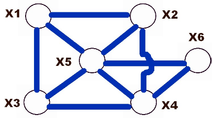
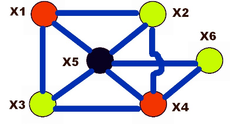
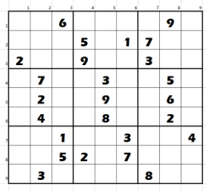
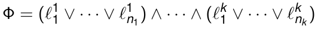
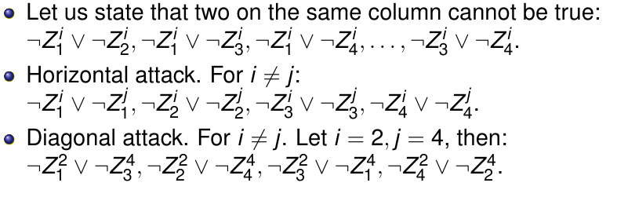

# NP-Hardness

We can use a CSP to encode and solve a NP problem.
An example of this problem is the 3-coloring problem.
We have a graph and we need to color the graph in a way that every adjancent
node has different color, using only 3 colors at our disposal.

We can  have this kind of solution using red, green and black colors.

We have six variable each with a domain of: *D1 = ... = D6* = {red, green, black},
and we have the following constraints:
X1 != X2, X1 != X3, X1 != X5, ... , X5 != X6.

Another famous CSP problem is the sudoku problem:

- The domain of our variable will be between {1, ..., 9}
- Our constraints force us to avoid the same number on same row,
  column and the inner square.

# SAT SOLVING

SAT Solving involves a set of boolean variables *X1, ... , Xn*
(i.e., *D1 = ... = Dn = {0, 1}*)

And we also have a CNF (Conjunctive Normal Form)

Where each *l_ij* is a variable *Xp* or the negation of a variable *¬Xp*.

The problem is establishing the existence of a satisfying assignment (for Φ) of
the variables in {0, 1}
We can see that it's a CSP (Xi ∈ {0, 1}) and any clause is a **CONSTRAINT**

E.g. (X1 ∨ ¬X2) (equivalent to ¬(¬X1 ∧ X2)) can be expressed,
e.g., by X1 + (1 − X2) ≥ 1 (i.e., {(1, 0), (1, 1), (0, 0)}.

Remember that 0 ∨ 0 = 0, 0 ∨ 1 = 1 ∨ 0 = 1 ∨ 1 = 1,
0 ∧ 0 = 0 ∧ 1 = 1 ∧ 0 = 0, 1 ∧ 1 = 1, ¬0 = 1, ¬1 = 0

SAT was the first problem proved to be NP-complete, thus every instance of a problem
in NP can be transformed in SAT instance.
A problem modeled as a CSP (on finite domains) is typically in NP
thus we can solve it
by reducing (transforming) it to an instance of SAT.
Then we can use a SAT solver, we'll use clasp/clingo.
Reductions can be not immediate.

If we go back to our 4 queens problem and model it based on a SAT problem we get:

- We start from our 4 variables *X1, X2, X3, X4* having values in {1, ... , 4}
- For each of them we introduce 4 boolean variables: *Zi1, Zi2, Zi3, Zi4*
Let us state that one of them is true: *Zi1 ∨ Zi2 ∨ Zi3 ∨ Zi4*

We should also consider that is not always worth to convert a CSP into a SAT problem.

Using constraint solvers allows us to:

- Write an higher level type of program, since constraint carry high level info.
- We can use constraint propagation

Meanwhile using a SAT solver we get:

- More variables -> that means we'll  have a larger search space.
- Learning from errors, this is not available in constraint solvers.
- Unit propagation
