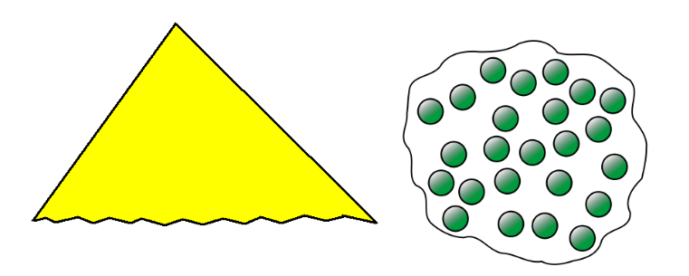
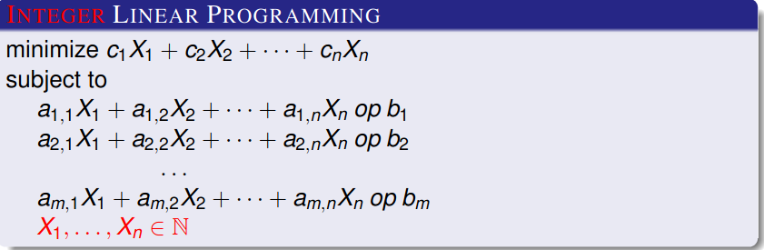
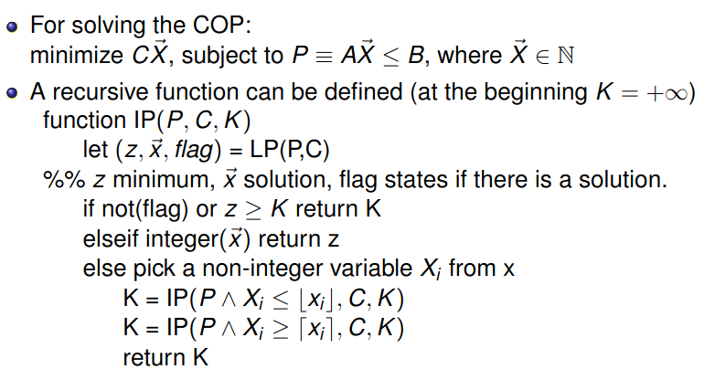
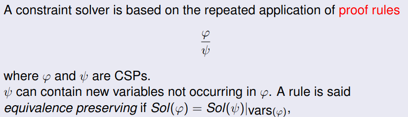

# Local Search

It allows us to explore our combinatorial space with random
choices.

Given a possible solution the algorithm
performs some changes, i.e, it evaluate other leaves.
There are several techniques (Montecarlo, Simulated Annealing,
Particle Swarm, Ant Colony, Genetic, ...)

With random guess we can also define a neighborhood so 
we know which values to check in the next iteration.

If we can control our next step, then the local search allows us to explore a solutions without considering the exponentiality of our search space.

We can also remove some constraint and count how many mistakes have been made, allowing us to reduce constraint making it easier to find an initial solution.

Let's define local search:
- We need an algorithm for finding the initial solution
- We need a function *N* that computes the **NEIGHBORHOOD**
  of a solution *σ* that identifies a set *N(σ)* of 
  solutions similar to *σ* 
- If possible, the Neighborhood is characterized by a simple move 

We shouled be careful when making a move:
- How to select a move
- How to explore the Neighborhood
- How to avoid undesirable solution/situations (ex. loop)
- How/When halting the computation (typically after a fixed number of tries, or non improving steps).

We also need to be careful when dealing with solution history, we could end up with an exponential use of space.

# Main meta Heuristics 

Given a solution *σ*, compute *N(σ)*
- **HILL CLIMBING**: choose *σ'* ∈ *N(σ)*, minimizing locally *f*, namely *f(σ')* = min{f(μ) : μ ∈ N(σ)}

- **SIMULATED ANNEALING**: 
Let *T* (Temperature) be
a global variable slowly decreasing during computation.
We choose randomly *σ'  ∈ N(σ)*

If  *f(σ′) < f(σ)* take  σ' as a new solution.

Otherwise, generate a random number *p ∈ [0, 1]*

Let *F* be a function [0, 1] that increases as *T* decreases and that also computes the distance between *f(σ)* and *f(σ')*.

If *p > F (T , f (σ), f (σ′))* then take *σ'* as a new solution, otherwise go to * (choose a new random σ' ∈ N(σ) and repeat last items.)

- **MONTE CARLO**: 
It is a sort of Simulated Annealing with fixed Temperature and *F* = 0.5.

- **TABU SEARCH**: 
It is a Simulated Annealing, with the difference that we store a list (tabu list) if the last k solutions in order to avoid loops.

## When to use local search
We can use it  for discrite optimization problems where the notion of swap is natural; for example with combinatortial problems.
We  can use it for continious problems, like simulations 
It's easy to implement, but it's better to use an ad hoc tool and focusing on the problem and on the meta-heuristics.

In constraint problems we don't have a solution history.

# (Integer) Linear Programming 

*op* is typically =<.
= and >= are easy to support, while < and > need some work to be done.

To sum it up, it's basically a COP with constraints and a linear cost function(*f*)

## When is it suitable?

A COP in Linear Programming admits a polynomial solution.
If your COP is in this class use absolutely LP tools.

## Branch and Bound 

Branch, because i need to explore to areas. One will improve the score of the scoring function, while the other will worsen it.

"Sometimes we can sacrifice constraints to improve performance"?? I think because this will reduce the "checking" process when solving a problem, but I'm not sure.

Look to example at slides: 15

Slides 17-18 are reminders of previous lectures.

# Constraint solving 

## Constraint solver 

A constraint solver is a procedure capable of transforming a CSP *P* into an equivalent CSP. It is:

- **COMPLETE** if, given an input CSP *P*, it always transforms *P* in a finite disjunction of simple (solved form) CSP, globally 
equivalent to *P* (or to *false* if it is unsatisfiable).
A solved form constraint is an implicit description of its solutions.

- **INCOMPLETE** *P* is transformed in a simpler equivalent CSP but solutions are implicit, they cannot be determined by directly combining domain values.

Equivalent CSPs may contain a larger number of variables.
Admissible solutions sets, restricted to the same variables, are equal.

Incomplete solver can offer an approximation of our solution while being faster than complete solver.

## Proof rules 

