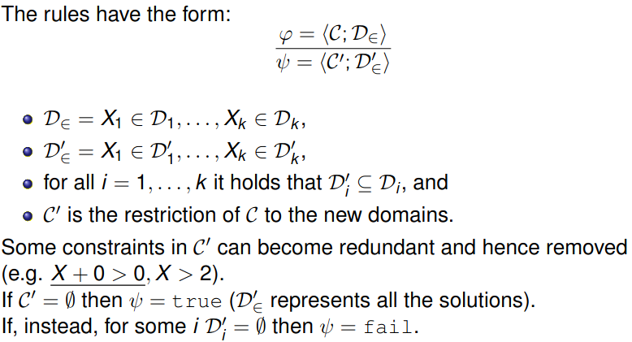
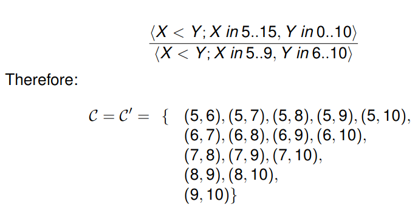
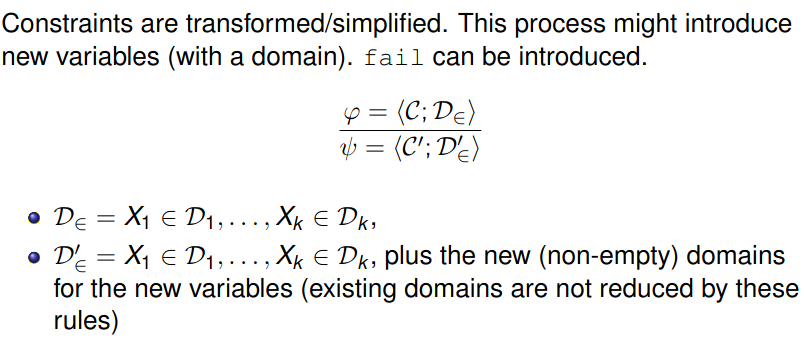
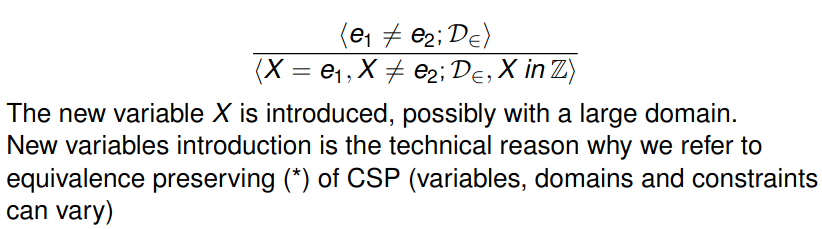
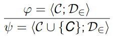
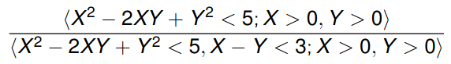
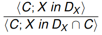
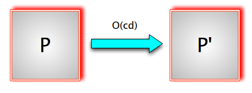
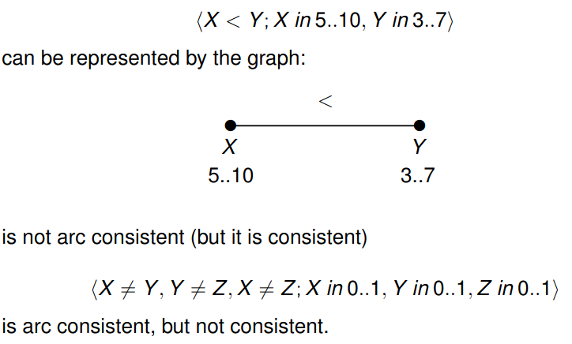
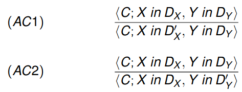

# Domain reduction

It allows us to discard some values that we know we won't get a valid solution for them.
We can discard values by exploiting the information we get from constraints.

Let's look at an example:

## Transformation rules 

Let's look at an example:

## Introduction rules 

Sometimes we need, or prefer, to introduce new constraints, typically weaker than existing ones: 

where C is a new constraint.

Let's have a look at an example: 

Consider this rule with variables in **R**

The new constraint does not introduce new information being implied logically by the other.
However, simple constraints allow a more effective constraint based reasoning.

Less variables -> more complex constraints
More variables -> simpler constraints.

# Constraint propagation 

The repeated application of a set of rules (domain reduction, transformation, introduction) is called **CONSTRAINT PROPAGATION**

A *derivation* is a sequence of application of the proof rues, with a suitable variable renaming instantiating the rules of the actual CSP. 

A finite derivation is:
- *failing* if the last CSP is *fail*.
- *stable* if it is not failing and no rule can be applied to the reached CSP.
- *successful* if it is suitable and the final constraint is in **SOLVED FORM**

As a general consideration, constraint propagation **MUST** be computationally efficient (polynomial time) at every rule application

The filtering phase **NEEDS** to be fast using a simple algorithm.

# Local Consistency

**NODE CONSISTENCY**:
A CSP *P* is *node consistent* if for each variable *X* in *P*, every **UNARY** constraint on *X* coincides with the domain of *X*. 

〈X1 ≥ 0, X2 ≥ 0; X1 in N, X2 in N〉this is node consistent.

〈X1 ≥ 5, X2 ≥ 1; X1 in N, X2 in N〉this is not N.C (but it is consistent since it admits solutions)

〈X1 6 = X2, X1 = 0, X2 = 0; X1 in 0..0, X2 in 0..0〉this is N.C but not consistent. 

Node consistency can be achieved by repeating the application of the following *domain reduction* rule: 

where C is a unary constraint on X.

**COMPLEXITY** O(cd) where c = |*C*|, d = max_i|D_i|

We should be careful since we have this high complexity

------------------------------------------------------------
We have seen the **NODE CONSISTENCY** property and how to achieve it.
The domain reduction rule for Node Consistency never increases domains (it is, in a sense, monotone). This property ensure that the order of rule application is immaterial. 

Let us see now the **ARC CONSISTENCY** property.

# Arc Consistency

A binary constraint *C* on the variables *X* and *Y* with domains Dx and Dy is arc consistent if:
- (∀a ∈ Dx )(∃b ∈ Dy ) ((a, b) ∈ C), and 
- (∀b ∈ Dy )(∃a ∈ Dx ) ((a, b) ∈ C)

A CSP <*C*;D∈> is arc consistent if all binary constraint in *C* are arc consistent.

The words Arc and Node come from graphs. It's common to deal with a constraint graph where nodes are variables and arcs are binary constraints between the two variables.

Let's have a look at a arc consistency example:

Arc consistency can be obtained by repeating the application of the following *domain reduction* rules:

where *C* is a binary constraint on *X* and *Y*:
- D'_x = {a ∈ Dx : (∃b ∈ Dy )((a, b) ∈ C)}
- D'y = {b ∈ Dy : (∃a ∈ Dx )((a, b) ∈ C)}

--------- Look at example from slide 36 to 38.

# Summary 

- *n* variables, *c* constraints, *d* maximum domain.
- Node Consistency: O(cd)
- Arc Consistency: O(ncd^3)
- Arc consistency rules only reduce the size of the domains:
order of application is not important. At the end a (unique) fixpoint is reached.

