# Bounds consistency

A binary constraint *C* on the variables *X* and *Y* with domains *Dx* and *Dy* is *bounds consistent* if:

- (∃b ∈ min(DY ).. max(Dy )) ((min(Dx ), b) ∈ C), and
  (∃b ∈ min(DY ).. max(Dy )) ((max(Dx ), b) ∈ C),
- (∃a ∈ min(Dx ).. max(Dx )) ((a, min(Dy )) ∈ C), and
  (∃a ∈ min(Dx ).. max(Dx )) ((a, max(Dy )) ∈ C),

A CSP <*C*; D∈> is bounds consistent if all its binary constraints are bounds consistent.

Let's have a look at an example:

 <2*X* = *Y*; *X* in {0, 1, 2}, *Y* in {0, 4}>

As a matter of fact, applying AC1 one would get:
  <2*X* = *Y*; *X* in {0, 2}, *Y* in {0, 4}>

The two rules for bounds consistency are the following:

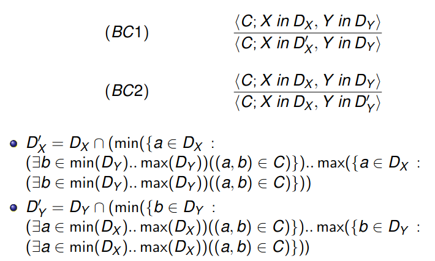

Rules for BC look complex, however they can be implemented in "almost" constant time.

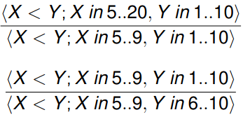

For < constraints you only need to check bounds of the domains.
Same idea for =, !=.

Look at slide 6.

# Directional arc/bounds consistency

In arc/bounds we require two properties.

We could imagine a (partial) ordering between variables and consider only one of them.

This will reduce the number of loops (possibly to just one)

In efficient implementations, each binary constraint is stored as a
pair of directed binary constraints.
As soon as, let's say, *Dx* is reduced, every constraint in which *Dx* appear at
the left of the pair, it is added to a queue to be directionally propagated.
This proves to very efficient.

# Non-binary constraints

## Hyper Arc consistency

It is a generalization of the arc consistency to constraints involving m >= 2 variables.

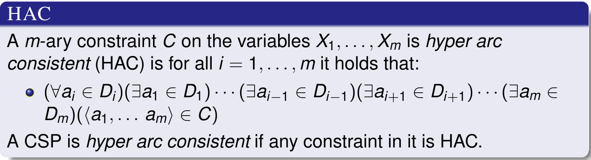

Let's look at an example:

〈2X + 3Y < Z ; X in 1..10, Y in 1..10, Z in 1..10〉

Any pair of values for *X* and *Y* force *Z* to be at least 6.
Thus, since 1 ∈ *Dz*, the CSP is not GAC.
The value 3 in *Dy* is also not supported.
With *Y* = 3 the expression in the l.h.s is at least 11 (2 + 9).
The equivalente HAC CSP is:
〈2X + 3Y < Z ; X in 1..3, Y in 1..2, Z in 6..10〉

HAC can be obtained by repeatedly applying the
rules (HACi) rules (for i = 1, ..., m):

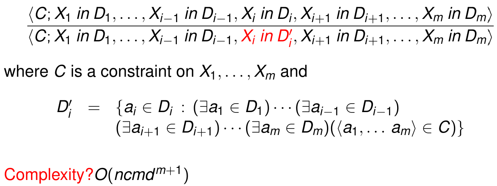

We should keep in mind that time complexity grows with more variables.

# Advanced forms of local consistency

## Constraint Propagation

A CSP *P* is *normalized* if for each pair of
variables *X*, *Y* (the order is not important) there is at most one binary constraint
including them in *P*.
If *P* is normalized, let us denote by *C(X, Y)* such a constraint if it exists.
Otherwise we can define *C(X, Y)* = *Dx* x *Dy*.
A CSP *P* is standard if for each (unordered) pair of variables *X, Y* there is exactly
one binary constraint on them (called *C(X, Y)*) in *P*.

Let's have a look at an example:

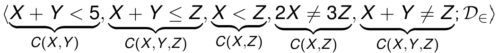

It is not normalized (there are two constraints for *X, Z*).
Anyway, we can imagine to replace *C1* and *C2*  by *C1* ∩ *C2*
(constraints are set of tuples!!!)

If we add the constraint *Dy* x *Dz* (let us call it *all*)
then the CSP becomes standard.

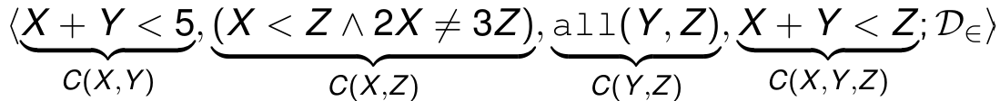

The rewriting algorithm just sketched can be formalized.
Any CSP can be converted to a standard and equivalent CSP
during the rewriting stage one can detect unsatisfiability by forcing
arc consistency.

〈X + Y = 0, X − Y = 0; X in {−1, 1}, Y in {−1, 1}〉

Is arc consistent but not standard.

〈(X + Y = 0 ∧ X − Y = 0); X in {−1, 1}, Y in {−1, 0, 1}〉

Is standard but not arc consistent.

Given a binary relation *R*, we denote R^T = {(b, a) : (a, b) ∈ R}
Given R and S binary relations, we denote:

RS = {(a, b) : ∃c ((a, c) ∈ R, (c, b) ∈ S)}

Definition for **PATH CONSISTENCY**:

A standard CSP is *path consistent* if for each triple of variables *X, Y, Z*
it holds that:
*C(X, Z) ⊆ C(X, Y)C(Y, Z)*
Namely, if whenever *(a, b) ∈ C(X, Z)* there is a **c** ∈ *Dy* such that
(a, c) ∈ C(X, Y) and (c, b) ∈ C(Y, Z).

Let us observe that implicitly it is also required that
C(X, Y) ⊆ C(X, Z)C(Z, Y) and C(Y, Z) ⊆ C(Y, X)C(X, Z)

Let's have a look at the following example.

Let's consider:
〈X != Y , Y  != Z , X  != Z ; X in 0..1, Y in 0..1, Z in 0..1〉

Then *C(X, Z)* = *C(X, Y)* = *C(Y, Z)* = {(0, 1), (1, 0)}
Observe that *C(X, Y)C(Y, Z)* = {(0, 0), (1, 1)}
and then
*C(X, Z) = {(0, 1), (1, 0)} !⊆ {(0,0), (1, 1)} = *C(X, Y)C(Y, Z)*
Namely it is not path consistent.

Let's take a lookt at path consistency proof rules:

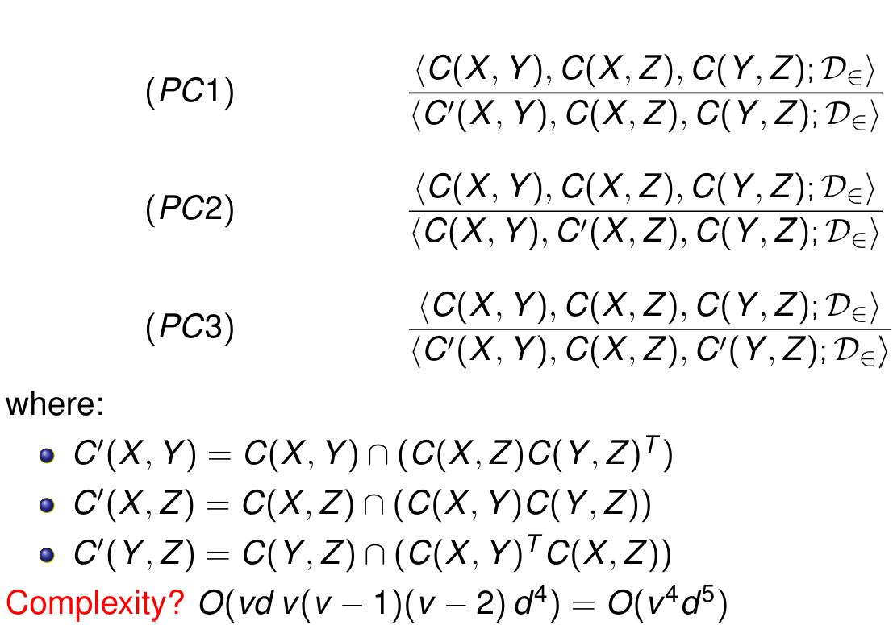

"k-consistency" it's a generalization of the previous notions.
It's useful for solving sudoku using k constraints for example.

Slide 21 is a revise of SAT solvers. One thing to add is that
constraint solving is an extension of a SAT solver.

# Unit propagation

Consider a clause like:
*X1 ∨ ¬X2 ∨ X3*

If the current assignment is *X1* = 0, *X2* = 1, you can
deterministically infer that *X3* = 1.

All clauses that are not already satisfied are checked.
If all but one literal are assigned, assign it deterministically and
proceed until there are not such clauses. This is a very effective form
of reasoning that reduces the search space.

There are clever techniques for implementing UP that avoid to scan
of all the formula (e.x watched literals)
Modern SAT solvers also use conflict driven clause learning, heuristics,
restarts and backjumping, parallelism.

**DPLL (1962)** ?????????? boh.

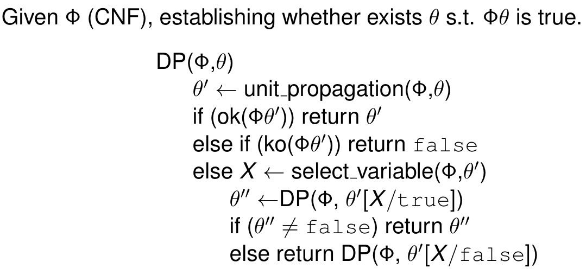

## Search space = Propagation + ND Assignment

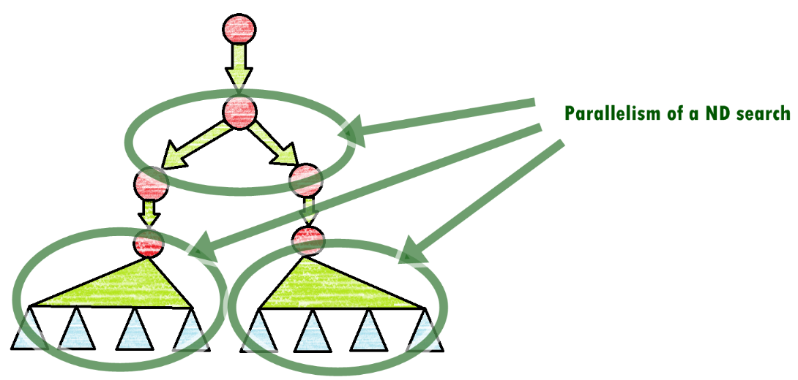

# Constraint Solving

As seen in DPLL for SAT, solution search alternates two stages:
non-deterministic choices and constraint propagation, aiming at
reaching some form of local consistency.

START: A variable is chosen, using a suitable heuristics, and its domain
is reduced, typically by assigning a value, but toher possibilities are considered
e.g, splitting the domain in two parts, etc...

- Alternatively, less frequent in implementations, a constraint is chosen and split.
- Then we apply propagation
- If a domain becomes empty, then we fail and we backtrack
- If there are no longer uninstantiated variables, the solution is returned.
- Otherwise, we go to START again.

Size and shape of the search tree depend on variable selection, on the
kind of propagation used, on the kind of assignment/domain reduction
rules employed.

We want to fail as soon as possible in order to remove possible solution from the search space.

Let's have a look at domain splitting rules:

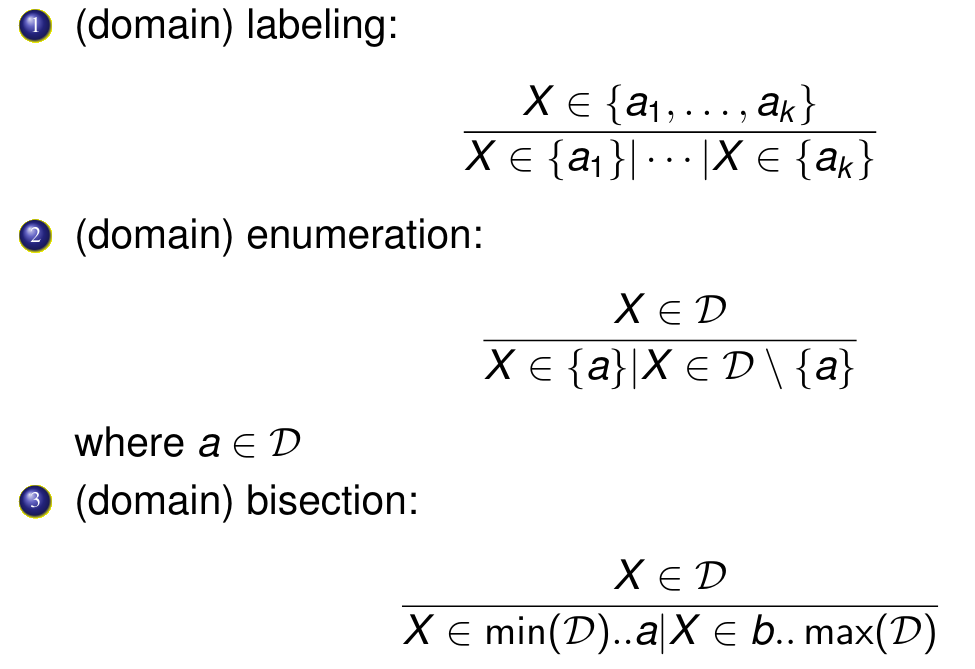

where *a, b ∈ D* and *b* is the element following *a* in *D*. If *D* is an internval
*x...y* choose a = [(*x + y*) / 2] and *b* = *a* + 1.

Let's look at some examples:

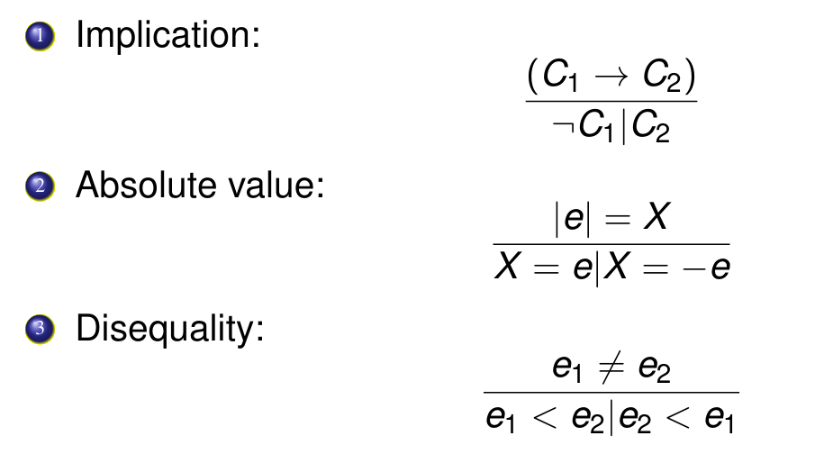

# Prop-Labeling-tree (X and Y)

Prop-Labeling-tree for X variable:

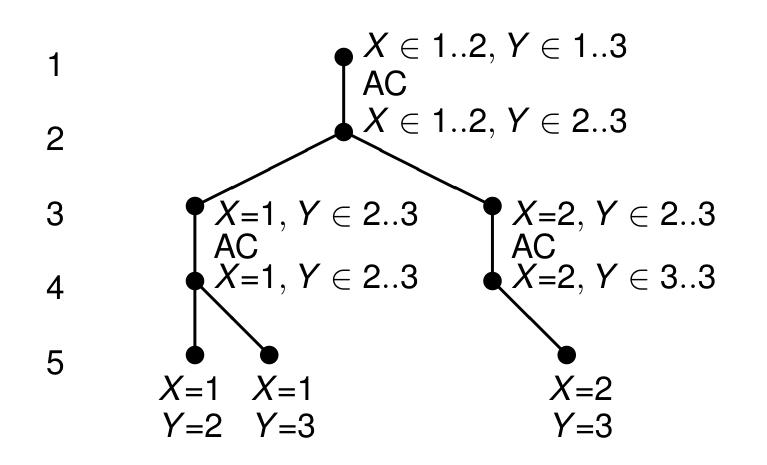

prop-labeling-tree for *P* = 〈X < Y ; X ∈ {1, 2}, Y ∈ {1, 2, 3}〉.

Let's take a look at the prop-labeling-tree for the variable Y

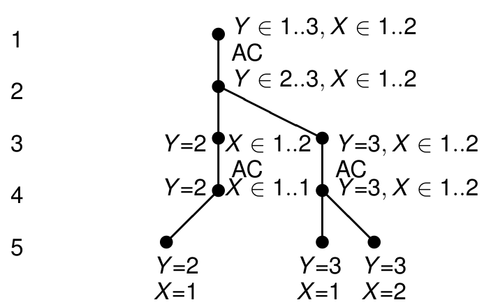

prop-labeling-tree for *P* 〈X < Y ; X ∈ {1, 2}, Y ∈ {1, 2, 3}〉

The construction and the visit of the prop-labeling-tree is called by
calling a built-inm in CLPFD is *labelling*, meanwhile in MiniZinc is *solve*

Every constraitn solver offers a set of parameters:
Variable choice algorithm (leftmost, ff, ffc, ...)
Value in the domain to be enumerated (min, max, med, ...)
Other parameters (approximated search, LNS, timeouts)

The following is an example of branch and bound for a COP (Constraint Optimization Problem)

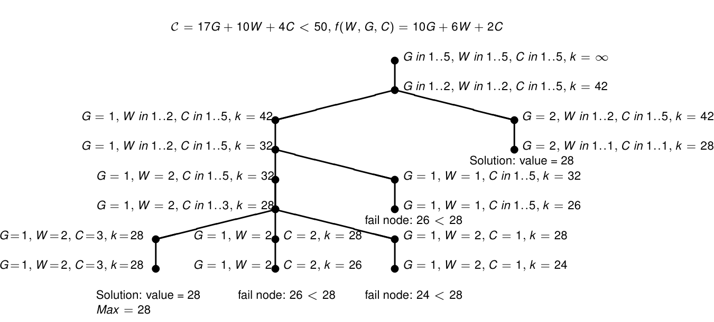
