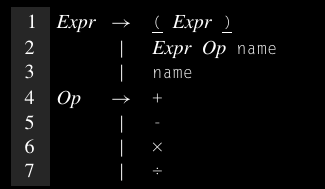
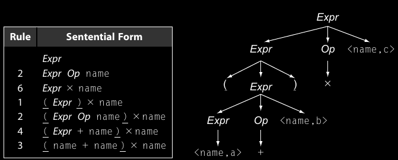
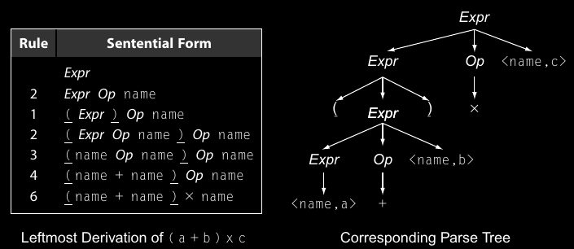
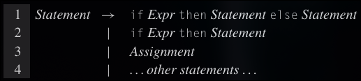
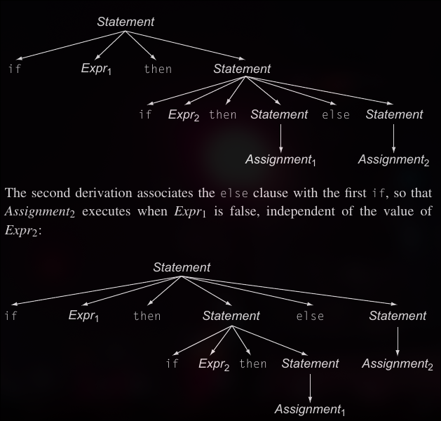
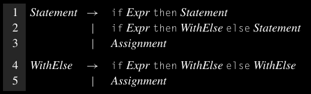
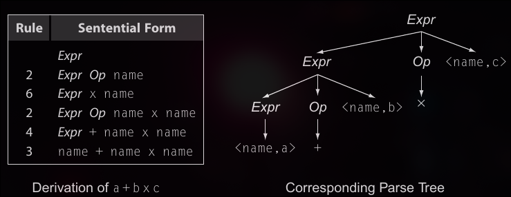
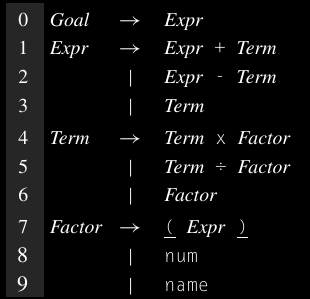
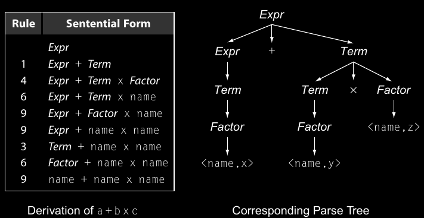

# Context Free Grammar (CFG)

Per specificarae linguaggi possiamo usare le RE (Regular Expression) come abbiamo già fatto, però una delle limitazioni delle RE è che non ci permettono di specificare in modo semplice grammatiche più complesse.
In questo caso utilizziamo le Context-Free Grammar, che ci permettono di specificare grammatiche più complesse in modo più intuitivo rispetto alle RE.

Context Free Grammar: per un linguaggio L insieme di simboli, e regole che permettono di riconoscere frasi che appartengono al linguaggio L

Frase: Stringa di simboli che può essere derivata dalle regole della grammatica G

Produzioni: Le regole della grammatica G sono chiamate anche Produzioni.

Simbolo terminale: una parola che può apparire nella grammatica. Una parola è composta da un lessema e dalla sua categoria sintattica. Le parole vengono rappresentate all'interno della grammatica dalla loro categoria sintattica.

Esempio di CGF:

SheepNoise -> baa SheepNoise 
            | baa

Questa grammatica permette 2 tipi di produzioni:
Partendo da SheepNoise possiamo ottenere "baa SheepNoise" oppure solamente "baa"
In questo caso SheepNoise è una variabile che rappresenta l'insieme delle stringhe derivabili; questo tipo di variabile è chiamata SIMBOLO NON TERMINALE.
Ogni parola definita dalla grammatica è un SIMBOLO TERMINALE; per esempio "baa" è una parola.

Formalmente una Context Free Grammar è una quadrupla: G(S, NT, T, P):
- S: insieme dei simboli di start, rappresenta le frasi in L(G)
- NT: insieme dei simboli non terminali, sono variabili sintattiche che permettono di dare struttura alle produzioni.
- T: insieme dei simboli terminali, dette anche parole. I simboli terminali corrispondono alle categorie sintattiche resituite dallo scanner.
- P: insieme delle produzioni della grammatica, dette anche regole. Ogni regola in P rimpiazza un singolo non terminale con una stringa formata da uno più simboli della grammatica.

## Esempio di derivazione 

Prendiamo la grammatica SheepNoise scritta in precedenza.
Partiamo con una stringa che consiste di un solo simbolo SheepNoise
Possiamo usare la prima regola di derviazione: baa | SheepNoise
oppure la seconda: baa

## Notazione

->+ significa che si deriva in uno o più passi di derivazione

## Esempio con grammatica più complessa 

Vediamo un esempio più complesso per vedere fino a che punto possiamo spignerci con le CFG. Prendiamo l' esempio di una grammatica per fare operazioni aritmetiche che sfrutta le parentesi per determinare la precedenza delle operazioni.

Partendo dal simbolo di start "Expr" possiamo ottenere due tipi di sottotermini: sottotermine tra parentesi con la regola 1, o senza parentesi con la regola 2.
Per generare la frase "(a+b)\*c" possiamo usare le seguenti produzioni in sequenza: (2,6,1,2,4,3). Ricordiamo che la grammatica si concentra di più sulle categorie sintattiche e non sui lessemi come name, a,b o c.

L'albero a destra lo chiamiamo *Parse Tree*, un grafo che rappresenta la derivazione della frase.

Questa semplice CFG non permette di generare una frase con parentesi sbilanciate, solo la produzione 1 permette di generare parentesi che sono già bilanciate. Quindi non permette di generare ad esempio: " a + ( b * c", (a +b * c. Frasi di questa forma verranno rifiutate dal parser.

Questo dimostra che le CFG ci permettono di generare costrutti che con le RE non sarebbero possibili.

Nell'esempio precedente abbiamo generato la frase (a + b) * c come derivazione più a destra, volendo possiamo anche generare la stessa frase con una generazione sinistra, questo produrrà una diversa sequenza di derivazione per la stessa frase, per esempio:

**Deriviazione più a destra**:  Una derivazione che riscrive ad ogni passo il simbolo non terminale più a destra.

**Deriviazione più a sinistra**: Una derivazione che riscrive ad ogni passo il simbolo non terminale più a sinsitra.

Per comodità si scrivera leftmost e rightmost

Le derivazioni leftmost e rightmost applicano lo stesso insieme di regole, ma le applicano in un ordine diverso, questo perché un parse tree rappresenta le regole applicate ma non l'oridine della loro applicazione.
I parse tree delle due derivazioni sono identici.

Per il compilatore è importante sapere se in una frase del linguaggio definito da uan CFG ha un'unica derivazione destra o sinistra, nel caso in cui ci fossero più derivazioni destre o sinistre che portano alla stessa frase si parla di *grammatica ambigua*.

Una grammatica ambigua può produrre più derivazioni e più parse tree per una determinata frase. Questo implica che ci possano essere più significati per un parse tree e questo per i compilatori è un problema perché non sarebbero in grado di tradurre in modo deterministico le frasi nella corretta sequenza di codice.

Vediamo un esempio di grammatica ambigua:

Questo frammento di grammatica ci mostra che else è opzionale. Purtroppo se guardiamo questo frammento di frase:

if Expr1 then if Expr2 then Assignment1 else Assignment2

Questo frammento ha 2 derivazioni destre distinte:

Queste due derivazioni hanno comportamenti diversi una volta che verranno inserite nel codice compilato.

Per rimuovere questa ambiguità ci conviene riscrivere la grammatica introducendo una nuova variabile. Possiamo riscrivere la grammatica in questo modo:

La soluzione restringe l'insieme degli statement che possono apparire nella parte then di un *if-then-else*. Accetta lo stesso insieme delle frasi della grammatica precendete ma ci permette di evitare mappare ogni *else* con il suo corrispondente *if* in modo da evitare ambiguità.

# Incorporare il significato nella struttura
L'esempio precendete sull' *if-then-else* ci mostra la relazione tra struttura grammaticale e ambiguità. Non è l'unico esempio dove questo avviene per esempio se prendiamo in considerazione l'esempio "a + b * c":

Il modo in cui valuteremmo questa espressione è tramite un attraversamento post-ordine. Valuteremmo prima a+b e poi moltiplicheremmo il risultato per C producendo il risultato (a + b) * c. Questa valutazione contraddice le regole di precedenza degli operatori matematici, perché dovremmo prima valutare b * c, e poi sommare a al risultato della moltiplicazione.

Il problema risede nella grammatica, perché tratta tutti gli operatori come se fossero uguali senza curarsi della precedenza delle operazioni.
Possiamo riscrivere la grammatica in questo modo:

In questa grammatica abbiamo *Expr* che rappresenta il livello per gli operatori + e -, *Term* rappresenta il livello per \* e /, e *Factor* rappresenta il livello per ( ).
Con questa forma la grammatica ci permette di derivare un albero consistente per "a + b * c" rispettando le regole algebriche.

Un attraversamento post-ordine di questo parse tree valuterà per prima cosa b * c, e aggiungerà al risultato il valore di a. Questo ci permette di implementare le regole basilari dell'artimetica.

Altri utilizzi sono la precedenza nelle operazioni con array per esempio:
"a + b[i]"   devo prima poter valutare "b[i]" e poi sommare a. Altri casi sono i type cast che hanno una maggiore priorità rispetto alle operazioni aritmetiche. 

