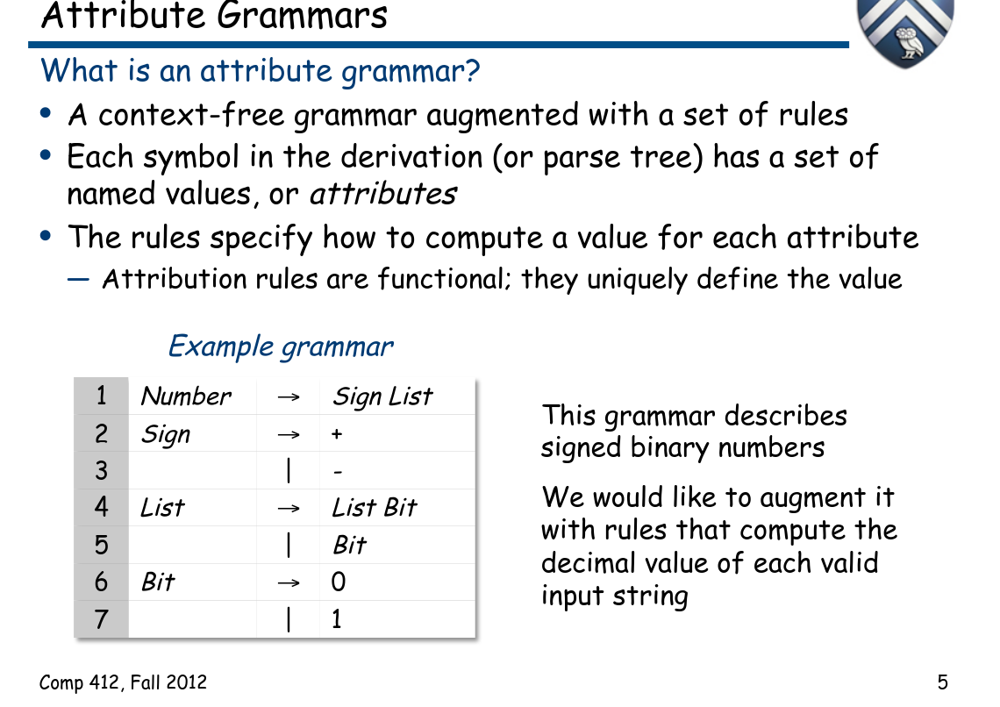
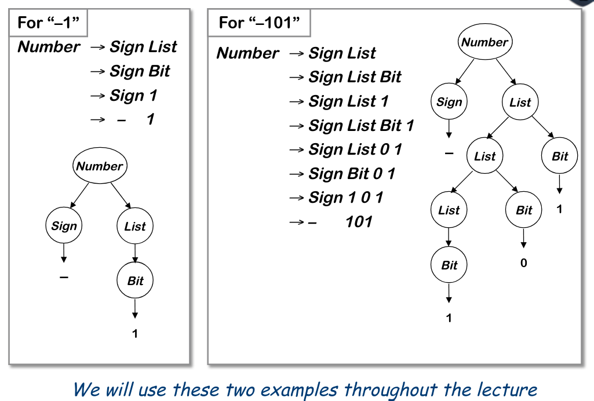
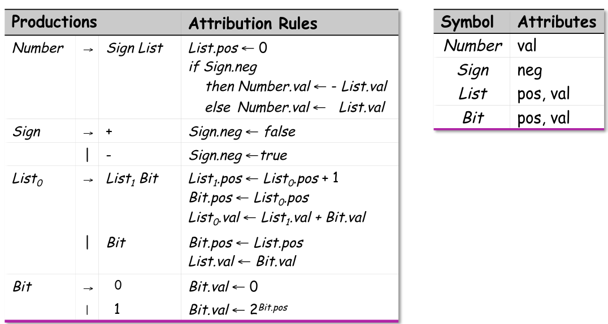
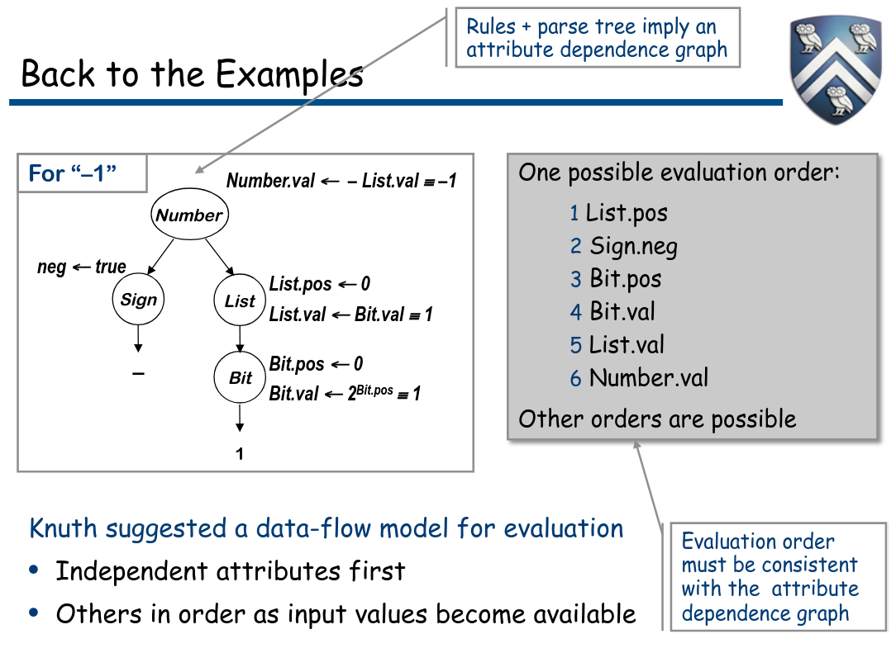
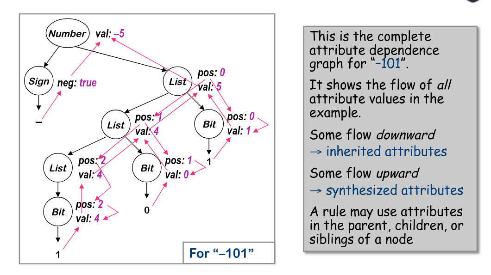
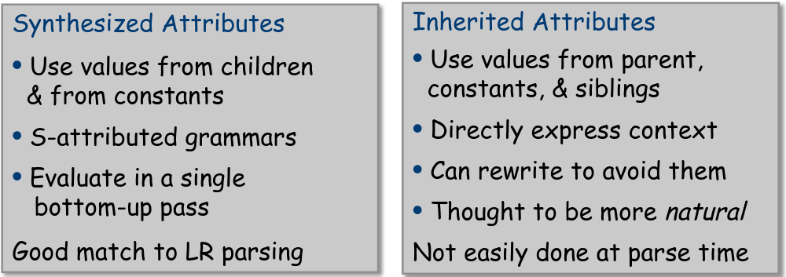
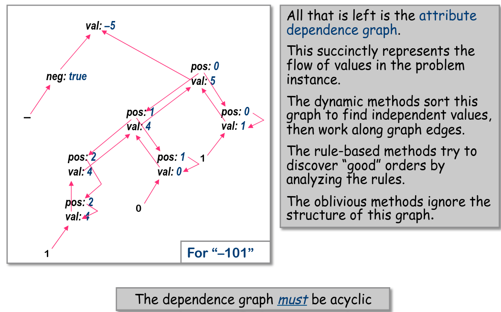

# Analisi dipendente da contesto

L'analisi dipendente da contesto risponde alle seguenti domande:

- Le risposte dipendono dai valori in gioco, non dalle part of speech
- Domande e risposte coinvolgono informazioni NON-locali
- Le risposte possono richiedere computazione

Per rispondere a queste domande usiamo tecniche ad hoc come:

- Metodi formali
  - Grammatiche dipendenti da contesto
  - Grammatiche con attributi

- Tecniche ad hoc
  - Tabelle dei simboli
  - Codice ad-hoc

A differenza della fase di parsing, dove abbiamo sfruttato parecchio
i formalismi delle grammatiche, qui utilizziamo al massimo tecniche
ad hoc "per questioni di efficienza".

La parte delle grammatiche con attributi verrà coperta ma solo per
questione di formalità.

## Grammatiche con attributi

È una grammatica CFG con l'aggiunta di un insieme di regole, dove
ogni simbolo nella derivazione, o parse tree, ha un insieme di
valori nominali, chiamati anche attributi.
Queste regole permottono di specificare come assegnare un valore
ad ogni attributo.
*Le regole di attribuzione sono funzionali; specificano unicamente il valore.*

Vediamo l'aggiunta degli attributi alla grammatica per calcolare
il valore di un dato numero binario

Viene aggiunto anche un simbolo a pedice sul simbolo *List* per
distingure a quale List io mi stia riferendo.

Ricapitoliamo come funzionano le grammatiche con attributi:

- Gli attributi vengono associati con il nodo nel parse tree.
- Le regole sono assegnamenti di valore associati alle produzioni della grammatica.
- L'attributo viene definito una volta, usando informazioni locali.
- Etichettare termini identici nelle produzioni per garantire l'unicità.
- Regole e parse tree definiscono un grafo di dipendenze degli attributi
  questo grafo deve essere NON-clico

Questo ci permette di produrre specifiche funzionali d'alto livello.
Ricordiamo che le grammatiche con attributi sono spefiche per la computazione
e non sono un algoritmo.
Ci sono due tipi di attributi:

- Attributi sintetici: dipendono dai valori dei nodi figli
- Attributi ereditati: dipendono dai valori dei fratelli e nodi padri.

Esistono anche linguaggi orientati al modello data flow.

Le grammatiche con attributi permettono anche di speficiare
azioni dipendenti dal contesto come:

- Prendere valori dalla sintassi
- Eseguire computazioni con valori
- Inserire test, logica, ...

Gli attributi sintetici sono ottimi per i parser bottom-up; perché
possono calcoalre gli attributi senza dover completare l'albero di parsing.
Invece gli attributi ereditati sono piuttosto ostici per i parser bottom-up
perché richiedono che l'albero di parsing sia completo.

**PARENTESI Ordinamento topologico di un grafo**:
I nodi di un grafo sono ordinati topologicamente se i nodi sono disposti
in modo tale che ogni nodo viene prima di tutti i nodi collegati ai suoi
archi uscenti. Non è un ordinamento totale poiché la soluzione non è unica.

## Metodi di valutazione

- Dinamico, metodi basati su dipendenze:
  - Costruire l'albero di parsing
  - Costruire il grafo delle dipendenze
  - Sorting topologico del grafo delle dipendenze
  - Definizione degli attributi in ordine topologico

- Metodi basati su regole (treewalk)
  - Analizazre le regole a tempo di compilazione
  - Determina un ordinamento fisso
  - Valutare i nodi in quell'ordine

- Metodi ignari (passes, dataflow)
  - Ignora le regole e il parse tree
  - Scegliere un ordine conveniente, a tempo di progettazione, e usarlo

Guardiamo un esempio di grafo delle dipendenze degli attributi

Questo grafo è stato ottenuto creando i sottografi degli attributi ereditati
e degli attributi sintetizzati e rimuovendo il parse tree.

Vogliamo evitare di avere alberi delle dipendenze ciclici, poiché il compilatore
potrebbe non generare codice corretto.
Dunque possiamo solamente valutare istanze acicliche, eseguire un test di circolarità
richiederebbe un tempo esponenziale, quindi preferiremmo evitare.

Il compilatore può anche restringere la grammatica a dutilizzare solo
attributi sintetizzati e attributi costanti eliminando la possibilità di avere
cicli all'interno del grafo delle dipendenze.

Possiamo dimostrare che alcune grammatiche possono generare istanze di
grafi delle dipendenze aclici:

- Le grammatiche "Strongly-non-circular" SNC
- Le grammatiche SNC possono essere testate in un tempo polinomiale
- Il fallimento del test per SNC non è conclusivo

Esistono altri metodi di valutazione per scoprire circolarità.

Ricordiamo che la circolarità riguarda le regole degli attributi, e non
coinvolge direttamente la grammatica CFG.

Guarda esempio da slide 21 a 27 pdf L16ContextSensitive-1up.pdf

Le grammatiche circolare hanno valori non determinati, ciò significa che
algoritmi di valutazione possono fallire.
Le grammatiche non circolari ci permeettono di valutare un unico insieme
di valori. Le grammatiche circolari possono genererare istanze non circolari,
ma non conviene usarle per via del tempo impiegato nei test.

Ricapitolando, dobbiamo evtiare cicli all'interno del grafo delle dipendenze
perché portano a computazioni non determinate. Se dovessimo usare solo
grammatiche non circolari, la fase di valutazione risulterebbe più semplice.

Guardare esempi da slide 29-36

s.31
Le proprietà delle grammatiche:

- Tutti gli attributi sono sintetizzati -> grammatiche S-attribuite
- Le regole possono essere valutate bottom-up in un solo passaggio
  ottimo per parser bottom-up, parser shift/reduce
- Soluzioni facili da comprendere
- Si addice al problema

Si potrebbe migliorare il modo in cui vengono caricati i valori, al momento
vengono caricati ad ogni blocco invece ad ogni uso, e non si tiene conto
di quali valori sono già stati caricati.

Appunti dalla lezione: I basic block devono essere massimali, di solito
l'ultima istruzione cambi ail flusso del CFG (Control Flow Graph)

s.33: "Expr1 -> after"

s.36:
Riassumendo, la computazione non-locale richiere un gran numero di
regole di supporto; anche la computazione locale era relativamente più semplice.

I problemi:

- Le regole di copia aumentano l'overhead cognitivo
- Ogni regola di copia aumenta lo spazio richiesto
  (come regola generale si fa in modo che il compilatore acceda a tutta la memoria
  che riserva, di solito più volte.)
  - Bisogna copiare gli attributi
  - Si possono usare i puntatori, anche per operazioni più complesse
- Il risultato è un albero degli attributi
  - Deve costruire il parser tree
  - Si cerca all'interno dell'albero per trovare le risposte o si copiano sulla root.

--------------------------------------------------------------------------------

**SLIDE: L17AdHoc-1up.pdf**

Uno dei problemi è contare i cicli la maggior parte delle implementazioni
sarebbero:

- Introdurre un "repository" centrale per i fatti
- Tabelle coi nomi
  - Campi nella tabella per per tenere traccia dello stato del caricamento
- Evitare le regole di copia, problemi di allocazione e salvataggio.
- Il flow degli di attributi di inter-assegnazione avviene tramite tabella
  - Implementazione pulita ed efficiente
  - Ottime tecniche per implementare la tabella
  - Quando è finito, le informazioni sono sulla tabella
  - Risolve la maggior parte dei problemi

Da qui nascono le tabelle di hashing per poter accedere ad un valore in un tempo
costante tramite una chiave.

A volte si scrive direttamente il codice invec edi usare una grammatica
prevalentemente per questioni di efficienza, questo processo prende il nome di
traduzione ad-hoc diretta.

Costruisce già partendo dai parser bottom-up e shift-reduce, associando una
porzione di codice ad ogni produzione della grammatica.
Ad ogni riduzione viene eseguita la porzione di codice interessata.
Permette di usare codice arbitrario che fornisce totale flessibilità; bisogna
tenere conto che può portare a azioni di cattivo gusto.

Per poter far funzionare questa traduzione ad-hoc:
Abbiamo bisogno di nomi per ogni simbolo nel lhf e al rhs; tipicamente
un attributo passa attraverso il parser + codice arbitrario (strutture, global, statics)
Yacc ha introddo $$, $1, $2, ... $n, da sinistra a destra.
Ci serve uno schema di valutazione:

- Si addice agli algoritmi di parsing LR(1)

esempi slide 4 - 10

Guardando alle implementazioni reali, la maggior parte dei parser utilizza questo
stile di analisi dipendente da contesto con la traduzione ad-hoc.

Vantaggi:

- Risolve le problematiche delle grammatiche con attributi
- Efficiente e flessibile

Svantaggi:

- Bisogna scrivere codice con il minimo aiuto
- Il programmatore interagisce direttamente con i dettagli implementativi

Gli usi tipici della traduzione ad hoc sono:
*la costruzione di una tabella dei simboli*,
a cui si aggiungo le informazioni della dichiarazione durante il processo.
Alla fine della dichiarazine della sintassi, si eseguono operazioni di post-processing.
Si usa una tabella per controllare gli errori man mano che la fase di parsing procede.
Si presuppone che la tabella sia globale.

*Check degli errori e dei tipi*:

- Dichiarare i valori prima dell'utilizzo -> lookup reference
- Dimensioni, tipo, ... -> si controlla quando si incontra.
- Conformità dei tipi di un espressione -> bottom-up walk
- Le interfacce delle procedure sono più complesse:
  - Costruire una rappresentazione per la lista di parametri e dei tipi
  - Crea una lista di "siti" (ovvero la chiamata della procedura) da controllare
  - Controlli offline, o gestire ordinamenti ordinari.

La regola di usare le cose **DOPO** averle definite, nasce dal fatto che permette
di semplificare notevolmente la fase di parsing.
