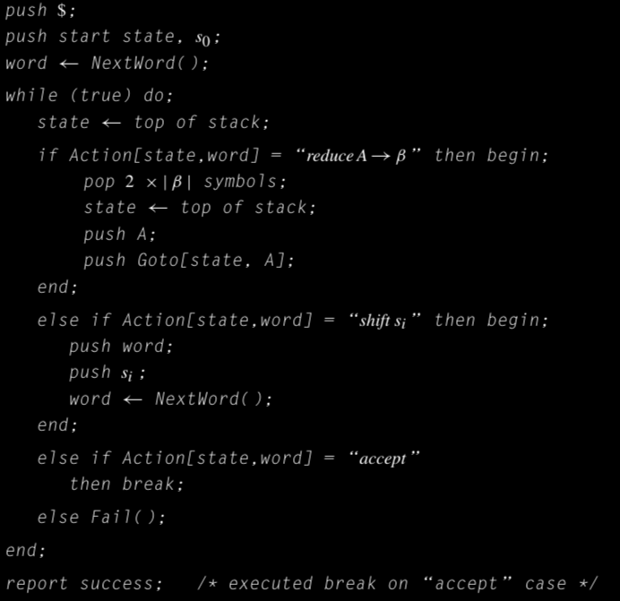
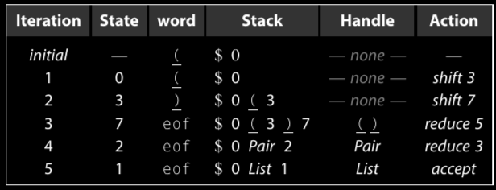
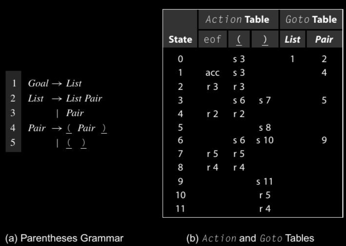
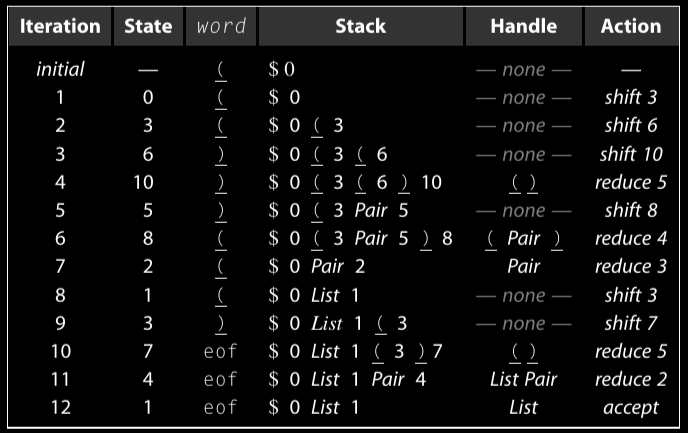

# Parser bottom-up

I parser bottom-up costruiscono l'albero di parsing partendo dalle foglie dell'albero fino ad arrivare alla radice. Il parser costruisce i nodi foglia partendo dallo stream di input ricevuto dal lexer (o scanner). Queste foglie formano la frontiera inferiore dell'albero di parsing. Per costruire una derivazione il parser aggiunge livelli di non terminali al di sopra delle foglie seguendo la struttura dettata dalla grammatica e dalla struttura parziale dell'albero.

A qualunque punto durante la fase di parsing, l'albero parzialmente completo rappresenta lo stato dell'operazione di parsing. Ogni parola ricevuta dallo scanner è rappresentata da una foglia. I nodi al di sopra delle foglie codificano tutta le informazioni che il parser è riuscito a derivare. Il parser lavora lungo la frontiera superiore dell'albero parzialmente completo, quella frontiera corrisponde alla forma sentenziale corrente nella derivazione costruita dal parser.

Per estendere la frontiera superiore dell'albero il parser guarda quella attuale che combacia con il right-hand side di una qualunque produzione *A -> β*. Se *β* si trova nella fronteira, con il suo estremo destro in *k*, allora può sostituire *β* con *A* per creare una nuova frontiera. Se rimpiazzare *β* con *A* nella posizione *k* è il prossimo step in una derivazione valida per la stringa di input, allora la coppia *<A -> β, k>*, è una **HANDLE** nella derivazione corrente e il parser dovrebbe sostituire *β* con *A*. Questa sostituzione prende il nome di *riduzione* perche ridce il numero di simboli sulla frontiera, a meno che |*β*| = 1. Se il parser sta costruendo l'albero di parsing, costruisce un nodo per *A*, aggiunge quel nodo all'albero e lo connette al nodo che rappresenta *β* come il figlio di *A*. 

### HANDLE
è una coppia, *<A -> β, k>*, tale che *β* appare nella frontiera con la sua estremità destra in posizione *k*, sostituire *β* con *A*  è il prossimo passo nella fase di parsing.

Si pùo vedere anche come la forma sentenziale che suddivide l'input tra la sequenza letta e quella da leggere, e di solito si trova in cima allo stack (preso dalla lezione 12 del 22/10/2025).

### RIDUZIONE (REDUCTION)

Ridurre la frontiera di un parser bottom up sostituendo secondo la produzione *A -> β*, significa sostituire *β* con *A* nella frontiera.

Il problema principale con i parser bottom-up è quello di trovare le handle giuste.

Il parser bottom-up è la ripetizione di un semplice processo, trova una handle *<A → β,k>* sulla frontiera e la sostitusce l'occorrenza di *β* in posizione *k* con *A*.

Questo processo va avanti finché:

- Riesce a ridurre la frontiera a un singolo nodo che rappresenta il simbolo di goal della grammatica
- Non riesce a trovare una handle

Nel primo caso il parser è riuscito a trovare una derivazione, e inoltre è riuscito a consumare tutte le parole dello stream di input (quindi l'unica parola rimasta è *eof*), allora il parsing ha avuto successo.
Nel secondo caso il parsernon può costruire una derivazione per lo stream di input quindi dovrebbe segnalarlo all'utente.

Quando un parser fallisce nell'operazione di parsing dovrebbe utilizzare tutte le informazioni raccolte fino a quel momento per generare un messaggio di errore significativo. In molti casi il parser può "riprendersi" dallo stato di errore per scoprire quanti più errori possibili.

La relazione tra derivazione e il parsing gioca un ruolo fondamentale nel rendere i parser bottom-up sia corretti che efficienti. Il parser bottom-up lavora partendo dalla frase finale fino a raggiungere il simbolo di goal, mentre una derivazione parte dal simbolo di goal e arriva alla frase finale. Il parser bottom-up di conseguenza scopre gli step di derivazione in ordine inverso. Per la seguente derivazione:

*Goal = γ0 → γ1 → γ2 → · · · → γn−1 → γn = frase*

il parser bottom-up scopre *γi → γi+1* prima di scoprire *γi-1 → γi*; il modo in cui costruice l'albero di parsing forza questo ordine. Il parser deve aggiungere il nodo per γi alla frontiera prima di poter trovare il match per γi. 

Lo scanner restituisce le parole in ordine da sinistra verso destra. Per "riconciliare" l'ordine delle parole dello scanner con la costruzione inversa della derivazione, il parser bottom-up punta alle derivazioni destre. In una derivazione destra la foglia sinistra è considerata per ultima; invertire l'ordine ci porta a un comportamento desiderato: prima la foglia più a sinistra e per ultima la foglia più a destra.

Ad ogni step, il parser opera sulla frontiera dell'albero di parsing che è in costruzione; la forntiera corrente è un prefisso che corrisponde alla forma sentenziale nella derivazione. Visto che ogni forma sentenziale compare nella parte destra della derivazione, il suffisso non esaminato è formato esclusivamente da simboli terminali. Quando il parser ha bisogno di più contesto a destra chiama lo scanner.

Con una grammatica non ambigua, la derivazione più a destra è unica. Per una ampia classe di grammatiche non ambigue, *γi−1* può essere determinata direttamente da *γi* (la frontiera superiore dell'albero di parsing) e con un limitato numero di lookahead nello stream di input. 

Insomma, data una frontiera *γi* e un limitato numero di simboli di lookahead, il parser può trovare una handle che prende *γi*  e arriva in *γi−1*. Per queste grammatiche possiamo costruire degli "handle-finder" usando una tecnica chiamata **LR Parsing**.

Un parser LR(1) "scannerizza" l'input da sinistra verso destra per costruire una derivazione destra al contrario. Ad ogni step prende una decisione basandosi sulla cronologia del parsing e sul lookahead, di al massimo, un simbolo. Il nome **LR(1)** deriva da queste proprietà:
- **LEFT-TO-RIGHT scan**
- **Reverse rightmost derivation**
- Lookahead di 1 simbolo

Possiamo anche dire che un linguaggio ha la proprietà LR(1) se può essere "parsato" con un solo scan da sinistra verso destra per costruire una derivazione destra inversa, usando un solo simbolo di lookahead per determianre le azioni per il parsing. Nella pratica un modo più semplice per determinare se una grammatica è LR(1) è lasciare che il generatore di parser provi a generare un parser LR(1), nel caso in cui non dovesse riuscirci allora la grammatica non è LR(1).

# Algoritmo di parsing LR(1)

La parte più critica in un parser bottom-up, per esempio un parser LR(1) guidato da tabella, è quella di trovare la prossima handle; se la ricerca della handle è efficiente, allora lo sarà anche il parser. 
Un parser LR(1) sfrutta un automa per trovare le handle, rappresentato da due tabelle *Action* e *Goto*.
Lo scheletro del parser LR(1) interpreta le tabelle *Action* e *Goto*  per trovare la handle successiva nella derivazione destra inversa della stringa di input. Quando trova una handle *<A -> →β,k>* riduce *β* in posizione *k* ad *A* nella forma sentenziale corrente: ovvero la frontiera superiore dell'attuale albero di parsing. Invece di costruire un albero di parsing esplicito, il parser scheletro mantiene la frontiera superiore corrente dell'albero parzialmente costruito all'intenro di uno stack, alternato con gli stati dell'automa per la ricerca degli handle, permettendo di collegare tra loro le riduzioni per formare un'analisi sintattica. In qualunque momento della fase di parsing, lo stack contiene un prefisso per la frontiera corrente. Oltre questo prefisso la frontiera è composta da nodi foglia. La variabile *word* contiene la prima parola nel suffisso che si trova oltre i contenuti dello stack, ed è il *simbolo di lookahead*.

Usare uno stack permette al parser LR(1) di rendere la posizione *k* della handle implicita e costante, ovvero in cima allo stack.

Per trovare la handle successiva, il parser LR(1) "shifta" i simboli sullo stack finché l'automa non trova nell'estremità destra di una handle in cima allo stack. Una volta trovata la handle il parser riduce utlizzando la produzione della handle. Per fare questo viene fatto il pop dei simboli in *β* dallo stack, ed esegue il push del corrispondente lato sinistro, *A*, sullo stack. Le tabelle *Action* e *Goto* uniscono azioni shift e reduce su una sequenza guidata dalla grammatica per trovare uan derivazione destra inversa, ammesso che esista.

Per capire meglio il comportamento dello scheletro del parser LR(1) consideriao la seguente sequenza di azioni per la string di input "*( )*".

La prima riga mostra lo stato iniziale del parser. Le righe successive mostrano lo stato del loop, insieme alle azioni da intraprendere. All'inizio della prima iterazione lo stack non contiene una handle, quindi il parser "shift" il simbolo di lookahead, *(* sullo stack. Dalla tabella *Action* sa che deve fare shift e mettersi nello stato 3. All'inizio della seconda iterazione, lo stack continua a non avere una handle, quindi il parser "shifta" *)* sullo stack per costruire ancora più contesto, e poi si sposta nello stato 7. Nella terza iterazione le cose cambiano, siamo riusciti a trovare una handle *<Pair -> ( )>, t* dove *t* è la cima dello stack. La tabella *Action* dice al parser di ridurre *( )* in *Pair*.  Usando lo stato sotto *Pair* all'interno dello stack, lo stato 0, e *Pair* il parser si sposta allo stato 2 (specificato da *Goto[0, Pair]*). Nello stato 2, con *Pair* in cima allo stack e *eof* come lookahead, il parser trova la handle *<List -> Pair, t>* e riduce, lasciando il parser nello stato 1 (specificato da *Goto[0, List]*). Infine nello stato 1, con *List* in cima allo stack e *eof* come lookahead, il parser trova la handle *<Goal -> List, t>*. La tabella *Action* dice che in questa situazione siamo in uno stato *accettante* quindi il parsing si arresta.

Questo parsing ha richeisto due shift e tre reduce; i parser LR(1) in genere impiegano un tempo proporzionato tra la lunghezza dell'input (uno shift per parola restituita dallo scanner) e la lunghezza della derivazione (una reduce per ogni step della derivazione). In linea generale non possiamo aspettarci di trovare una derivazione per una frase con un numero di step inferiore.

Guardiamo il caso della stringa di input "( ( ) ) ( )".
Il parser esegue 6 shift e 5 riduzioni, e un'accettazione per questo input. 

## Saltati: "Handle Finding" e "Parsing an Erroneous Input String"

## Utilizzo parser LR 

L'utilizzo dei parser LR risiede nella costruzione delle tabelle *Action* e *Goto*. Le tabelle rappresentano tutte le sequenze legali di riduzioni che possono comparire in una derivazione destra inversa per una data grammatica. Anche se il numero delle sequenze è elevato, la grammatica stabilisce l'ordine in cui possono comparire. Chi scrive il compilatore può costruire le tabelle *Action* e *Goto* a mano, ma il processo risulta tedioso e minuzioso; conviene delegare il processo a un programma per automatizzarlo.

Con un generatore di parser LR(1), il compito di chi scrive il compilatore è assicurarsi che la grammatica sia LR(1). Nella pratica il generatore di tabelle per LR(1) identifica quelle produzioni che sono ambigue o che sono espresse in modo tale da richeidere più di una parola di lookahead per distinguere tra l'azione di shift o di reduce. 

(Paragrafo qui sotto preso dalle slide L14LRPArser.pdf, slide 19)
Per riassumere gli LR(1) funzionano grazie a una grammatica non ambigua che garantisce una derivazione destra unica. Mantengono la frontiera superiore dell'albero su uno stack:
- Tutte le handle attive sono sulla cima dello stack
- Viene eseguito lo shift degli input finché la cima dello stack non è nel lato destro di una handle.

Il linguaggio delle handle è un linguaggio regolare:
- Si costruisce un DFA per controllare il riconoscitore basato su pila.
- Le tabelle ACTION e GOTO rappresentano il DFA.

Per fare matching di un sottotermine si invoca ricorsivamente il DFA, lasciando il vecchio stato del DFA sullo stack e proseguendo con il parsing.

Quando il DFA arriva in uno stato finale allora dobbiamo eseguire una azione di reduce:
- Viene eseguito il pop del rhs (right-hand side) per ottenere lo stato da cui la produzione è stata invocata.
- Il nuovo stato sarà *GOTO[revealed state, lhs]*
- Prendiamo una transizione del DFA sul nuovo non terminale, ovvero il lhs che abbiamo appena "pushato" sullo stack.

# Costruzione tabelle LR(1)

Per costruire le tabelle *Action* e *Goto*, un generatore di parser LR(1) costruisce il modello dell'automa per riconoscere le handle e usa quel modello per popolare le tabelle. Il modello, chiamato anche *collezione canonica di insiemi di elementi LR(1)*, rappresenta tutti i possibili stati del parser e le transizioni tra quegli stati. 

Per riassumere:
Per generare le tabelle *ACTION* e *GOTO* usiamo la grammatica per costruire il modello di un DFA di controllo, rappresentiamo le azioni e le transizioni nelle tabelle *ACTION* e *GOTO* e nel caso in cui la costruzione dovesse avere successo, allora la grammatica è LR(1). Per successo si intende che ogni entry della tabella è unica.

Quindi:
- Modellare lo stato del parser
- Usare due funzioni *goto(s, X)* e *closure(s)* 
  - *goto()* è analoga alla *move()* nella costruzione dei sottoinsiemi
  - *closure()* aggiunge informazioni per completare uno stato.
- Costruire gli stati e le funzioni di transizione del DFA (Algoritmo a punto fisso, simile alla costruzione dei sottoinsiemi)
- Usare queste informazioni per popolare le tabelle *ACTION* e *GOTO*

# LR(1) Items 

In un parser LR(1), le tabelle *Action* e *Goto* rappresentano le informazioni sulle potenziali handle ad ogni step durante la fase di analisi sintattica. Dunque, l'algoritmo di costruzione delle tabelle necessita di una rappresentazione concreta sia delle handle, che delle potenziali handle e dei loro simboli di lookahead. Ogni potenziale handle viene rappresentata tramite un item LR(1). 
Un item LR(1) *\[A→β•γ, a]* consiste in una produzione  *A -> βγ*; un placeholder, •, serve a indicare la posizione  della cima dello stack nelle produzioni del right-hand side; e ha uno specifico simbolo terminale come simbolo di lookahead, *a*.

--------------------------------------------------------------------------------------------------------------------------------- 

*La sezione seguente è presa dalle slide L14-Parsers-1-up.pdf; da slide 21 a * 

Un item LR(1) è uan coppia *\[P, δ]* dove:
*P* è una produzione *A -> β* con *a* • in una posizione del rhs; δ è un singolo simbolo di lookahead.
La • indica la posizione in cima allo stack.

*[A -> •βγ,a]* signfiica che l'input visto fino ad ora è consistente con l'uso di *A -> βγ*   immediatamente dopo il simbolo in cima allo stack.

*[A →β•γ,a]* significa che l'input visto fino ad ora è consistente con l'uso di *A -> βγ* fino a questo punto del parsing, e che il parser ha gìa riconosciuto *β*, quindi *β* è in cima allo stack.

*[A →βγ•,a]* significa che il parser ha visto *βγ*, **E** che il lookahead di simbolo *a* è consistente con la riduzione ad *A*

*I parser LR(k) si basano su item con un lookahead di <= k simboli. Questo porta gli item LR(k) ad avere δ corrispondenti più lunghe.*

La produzione *A -> β*, dove *β = B1 B1 B1* con un lookahead di *a*, può far ottenre 4 items:

[*A -> • B1 B2 B3, a*], [*A -> B1 • B2 B3, a*]. [*A -> B1 B2 • B3, a*] e [*A -> B1 B2 B3 •, a*]

L'insieme degli item LR(1) per la grammatica è **FINITO**.

*Perché usare tutti questi simboli di lookahead?*

- Tenerne traccia permette di aiutare nella scelta della riduzione corretta.
- I lookahead servono come "contabilità", a meno che l'item  non abbia "•" alla fine.
  - Non c'è nessun uso diretto in [*A -> β•γ, a*]
  - Nel caso [*A -> β•,a*], un lookahead di *a* implica una riduzione *A -> β*
  - Per { [*A -> β•,a*], [*B -> * γ•δ,b*] }, *a* => riduci ad *A*; FIRST(δ) => shift
  
  Anche un contesto destro limitato può bastare per prendere decisioni corrette.

Per la costruzione delle tabelle dobbiamo costruire la collezione canonica degli insiemi degli items LR(1), *I*.
- Partiamo da uno stato appropriato, S0.
- [S’ -> •S,EOF], insieme a qualunque item equivalente.
- Deriviamo gli item equivalenti come *closure(S0)*

- Iteriamo per ogni Sk, e ogni X, goto(Sk, X) (questa è la funzione goto e non la tabella GOTO)
- Se l'insieme non è già nella collezione, viene aggiunto
- Registrare tutte le transizioni create dalla goto().
Eventualmente arriveremo a un punto fisso (come l'algoritmo di Hopcroft)

Infine popoliamo la tabella con la collezione degli insiemi.

*Proseguire con slide 25*

