# Breve riassunto

Abbiamo visto come utilizzare una CFG (Context Free Grammar) G per poter generare frasi che appartengono al linguaggio L(G), il compilatore invece deve dedurre una derivazione per la stringa in input o determinare che non esista una derivazione possibile. Il processo di costruzione delle derivazioni per delle stringhe in input prende il nome di **PARSING** 

Un parser prende in input un programma scritto in un determinato linguaggio.
Il parser vede il programma dopo che è stato "elaborato" dal lexer come uno stream di parole con la loro categoria sintattica, per esempio:

La frase "a + b * c" il parser la vede come: <name, a> + <name, b> * <name, c>.
Come output il parser deve produrre una derivazione per questo input o un messaggio di errore nel caso in cui non sia possibile trovare una derivazione valida.

In un linguaggio NON ambiguo il parse tree è equivalente a una derivazione quindi possiamo considerare l'output del parser come un parse tree.
Ci viene comodo visualizzare il parser come un costruttore di alberi sintattici per il programma che ci viene dato in input. Conosciamo la radice, che rappresenta il simbolo di start della nostra grammatica. Conosciamo le foglie e devono combaciare nell'ordine in cui vengono lette dallo scanner.
La parte complessa del parsing risiede nel trovare le giuste produzioni della grammatica partendo dal simbolo di start per ottenere le foglie che riceviamo dal lexer.

--------------------------------------------------------------------------

Vedremo due tipi di approcci per costruire gli alberi di parsing:

- *Parser Top-Down*, si parte dalla radice dell'albero e si espande finché non si arriva alle foglie. Ad ogni step il parser seleziona un simbolo non terminale di un nodo nella frontiera inferiore e lo estende con un sottoalbero che rappresenta il lato destro di una produzione che riscrive il non terminale.

- *Parser Bottom-Up*, si parte dalle foglie e si espande l'albero verso la radice. Ad ogni step il parser bottom-up deve identificare una sottostringa contigua della frontiera superiore dell'albero di parsing che combacia con il lato destro di una produzione; poi costruisce un nodo per la regola al lato sinistro e connette l'albero.

In entrambi gli scenari il parser prende una serie di decisioni su quali produzioni applicare, la complessità nella creazione del parser risiede nello scegliere QUALI produzioni applicare.

# Parser Top-Down

Un parser Top-Down parte dalla radice dell'albero di parsing e utilizza le produzioni della grammatica per costruire l'albero finché le foglie non combaciano con la strigna ricevuta in inuput dal lexer.
Seleziona un simbolo non terminale nella frontiera inferiore dell'albero ceh corrisponde a una produzione sul right hand side di un simbolo non terminale.Non può estendere la frontiera da un simbolo terminale; questo processo continua finché:
- La frontiera dell'albero contiene solo simboli terminali e lo stream in input è stato completamente consumato, oppure
- Ci troviamo davanti ad un mismatch tra la frontiera dell'albero costruito fino a quel punto e lo stream di input.

Nel primo caso il parsing viene completato con successo, mentre nel secondo possiamo ritrovarci davanti a due scenari:
Il parser ha scelto una produzione errata in uno step precedente, in quel caso il parser può fare backtracking e cambiare la produzione applicata per errore. Se la stringa in input è valida l'operazione di backtracking ci porterà ad avere un albero di parsing corretto, mentre se la stringa non fosse valida l'operazione di backtracking fallisce e ci porterà a un errore di sintassi da parte dell'utente.

Un punto fondamnetale che rende i parser Top-Down efficienti è che esiste un sottoinsieme di CFG che possono essere "parsate" senza backtracking.

Vediamo un algoritmo che costruisce un parser top down con una derivazione sinistra. Costruisce l'albero di parsing partendo dalla variabile root. Sfrutta uno stack con funzioni *push()* e *pop()* per tenere traccia della frontiera dell'albero.

La parte principale del parser consiste in un loop che si concentra sul simbolo più a sinistra nella frontiera inferiore dell'albero di parsing da costruire. Se il simbolo individuato è un non terminale allora espande verso il basso l'albero, scegliendo una produzione che costruisce l'albero di parsing corrispondente, e sposta poi l'attenzione sul simbolo più a sinistra della nuova porzione dell'albero appena costruita. Se il simbolo è terminale lo confronta con la prossima parola di input. Nel caso in cui combacino ci si sposta al prosismo simbolo nella frontiera e si va avanti con lo stream di input.

Nel caso in cui il simbolo evidenziato sia un termianle e non combacia con l'input ricevuto il parser DEVE fare backtrack. Per prima coas considera le alternative per la regola appena applicata. Se le alternative soddisfano la condizione torna indietro nell'albero  e riconsidera le scelte ad un livello più alto nell'albero di parsing. Se questo processo dovesse fallire a combaciare con la stringa di input il parser resituisce un syntax error. Ovviamente vogliamo evitare di effettuare backtracking perché alla lunga aumenta il costo computazionale del nostro parser.

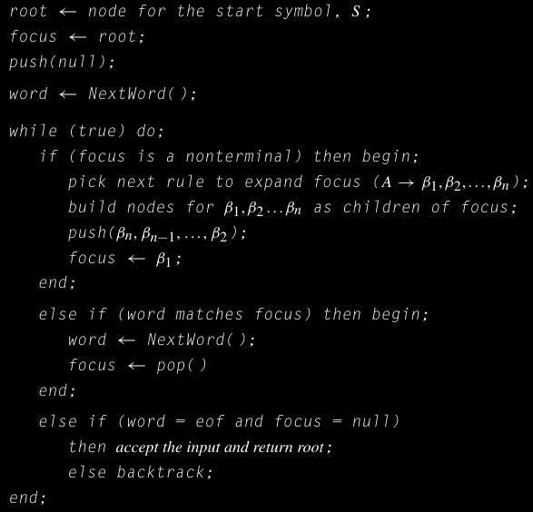

L'implementazione del *backtrack* è piuttosto immediata. *focus* viene settato al suo nodo padre nell'albero parzialmente costruito e scarta i suoi nodi figli. Se rimane una regola di produzione a sinistra sul simbolo *focus* allora il parser espande il nodo *focus* con quella regola. Costruisce i nodi figli per ogni simbolo sul lato destro, "pusha" sullo stack quei simboli in ordine da destra a sinistra, e imposta *focus* sul primo nodo figlio. Nel caso in cui non ci fossero altre produzioni da provare il parser torna su di un altro livello. Quando terminano le possibilità per il parser, viene lanciato un syntax error.
Ovviamente quando il parser procede con il backtracking deve anche tornare indietro con lo stream di input. Per fortuna l'albero parziale incorpora queste informazioni per rendere questa operazione efficiente. 

# Trasformazione di una grammatica per parsing Top-Down

L'efficienza di un parser Top-Down dipende dalla sua abilità di scegliere la corretta produzione da applicare ogni volta che espande un simbolo non terminale. Se il parser fa' sempre la scelta giusta, allora è un parser efficiente, in caso contrario il costo del parsing inizia a crescere. Per alcune grammatiche il caso peggiore è che il parser non termini mai, visto che noi vogliamo dei parser **DETERMINISTICI** dobbiamo evitare queste situazioni. 

Abbiamo visto in precedenza un esempio per quanto riguardava un espressione matematica "a + b * c". Ipotizziamo che il parser che deve leggere questa stringa in input abbia un oracolo che sceglie la produzione corretta da applicare ad ogni step. Con l'oracolo il parser dovrebbe fare un numero di step proporzionati alla lunghezza della derivazione + la lunghezza dell'input. Per "a + b * c" il parser ha applicato 8 regole e fatto combaciare 5 parole. 

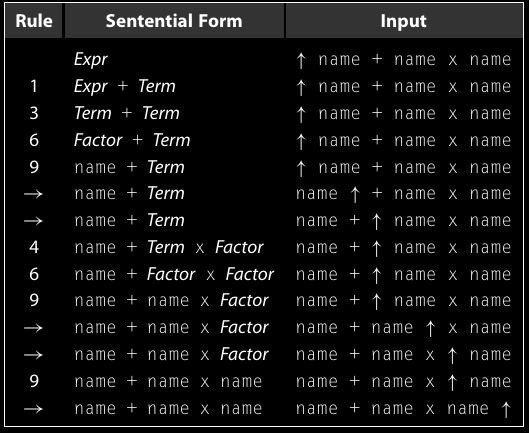

Le decisioni basate su un oracolo vuol dire anche avere delle scelte incosistenti. Nel primo e secondo step il parser ha considerato il non terminale *Expr*. Nel primo step ha applicato la produzione 1. *Expr -> Expr + Term*. Nel secondo step ha applicato la regola 3, *Expr -> Term*. In modo simile succede la stessa cosa quando ha cercato di matchare "a", applicando la regola 6, *Term -> Factor*, ma quando ha dovuto espandere *Term* per matchare "b" ha applicato la regola 4, *Term -> Term x Factor*. Risulta piuttosto difficile far lavorare il parser in modo consistente utilizzando questa versione delle grammatica. 

## Eliminazione della ricorsione sinistra.

Ricorsione sinistra: Una regola è ricorsiva in una CFG SE il primo simbolo più a destra è uguale al simbolo alla sua sinistra, o se può derivare quel simbolo.
Il primo caso viene chiamato ricorsione sinistra *diretta*, mentre l'ultimo prende il nome di ricorsione sinistra *indiretta*.

Un problema tra la combinazione di una grammatica espressa in forma classica e un parser discendente a sinistra nasce dalla struttura della grammatica.

Se prendiamo in considerazione un implementazione che prova sempre ad applicare le regole in base all'ordine in cui appaiono nella grammatica avremmo come prime derivazioni:

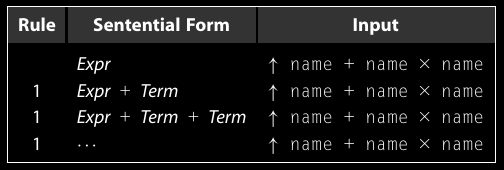

Come possiamo vedere parte con *Expr* e cerca di matchare "a", applica la regola di derivazione 1 per creare la forma sentenziale *Expr + Term* sulla frontiera. Ora si ritrova il simbolo non terminale *Expr* e di nuovo come input "a", quindi applica nuovamente la regola 1 per rimpiazziare *Expr* con *Expr + Term*. In questo caso il parser continuerà ad espandere l'albero all'infinito perché non incontra un simbolo terminale. 

Il problema nasce dal fatto che la grammatica sfrutta la derivazione senistra nelle sue produzioni 1, 2, 4 e 5. Con derivazione sinistra un parser Top-Down può derivare all'infinito senza generare simboli terminali.
Per noi un problema visto che vogliamo che i nostri parser siano **DETERMINISTICI**.

Possiamo riformulare una grammatica che usa ricorsione sinistra in modo che usi la ricorsione destra.
La traduzione da una grammatica ricorsiva a sinsitra a una ricorsiva a destra è piuttosto banale, nel caso di una ricorsione diretta, come mostrata nell'esempio qui sotto, possiamo riscrivere le produzioni in modo che abbiano ricorsione a destra.

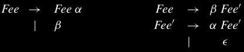

Questa trasformazione introduce un nuovo simbolo non terminale, *Fee'*, e sposta la ricorsione su *Fee'*. Inoltre aggiunge la regola *Fee'->ϵ* dove *ϵ* rappresenta la stringa vuota. Questa ϵ-produzione richiede attenzione per quanto riguarda l'algoritmo del parser. Per espandere la produzione *Fee'->ϵ* il parsere semplicemente setta *focus <- pop()* , che permette di passare al prossimo nodo, terminale o no, sulla frontiera.

Nella classica rappresentazioen della grammatica, la ricorsione diretta sinistra appare in entrambe le produzioni per *Expr* e per *Term*.

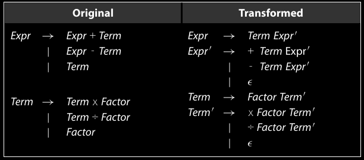

Con queste trasformazioni siamo passati da una ricorsione sinistra ad una grammatica con  ricorsione destra. Siamo riusciti ad eliminare una derivazione sinistra diretta, ma dobbiamo ancora risolvere una ricorsione sinistra indiretta, che può manifestarsi dopo una serie di produzioni in modo che *α→β, β →γ,  γ →αδ* crea una situazione del tipo: *α →+ αδ*.
Le ricorsioni indirette non sono sempre ovvie, possono essere nascoste da lunghe catene di produzioni della grammatica.

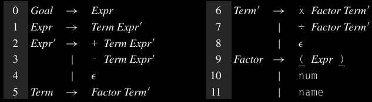

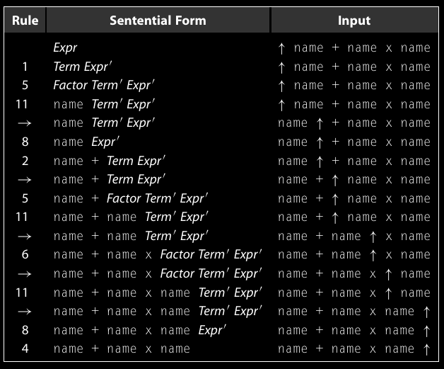

Per convertire la ricorsione sinistra indiretta in una ricorsione destra abbiamo bisogno di un approccio più metodico. L'algoritmo che vedremo permette di eliminare tutte le ricorsioni sinistre in una grammatica mediante l'applicazione 2 tecniche: sostituzione in avanti per convertire la derivazione sinistra indiretta in ricorsione sinistra diretta e poi riscrivere la ricorsione sinistra diretta in ricorsione destra. Si assume che la grammatica originale non abbia cilci *(A ->+ A)* e non abbia ε-produzioni.

L'algoritmo impone un ordine prestabilito sui simboli non terminali. Il ciclo più esterno cicla i simboli non terminali in ordine. Il ciclo più interno invece cerca una qualunque produzione che espande *Ai* in un right-hand side in modo che inizi con *Aj*. Se il loop interno scopre uan produzione *Ai -> Ajγ*, e *Aj -> δ1 |δ2|···|δk*, allora l'algoritmo rimpiazza *Ai -> Ajγ* con un insieme di produzioni *Ai ->  δ1γ|δ2γ|...|δkγ*.

Questo processo converte la ricorsione sinistra indiretta in una ricorsione sinistra diretta. L'ultimo step per il loop esterno è quello di convertire tutte le ricorsioni sinistre dirette su *Ai* in ricorsioni destre usando la trasformazione mostrata precedentemente. Visto che vengono aggiunti nuovi non terminali solo alla fine e riguardano solo la ricorisone destra l'algoritmo può ignorarle visto che non c'è bisogno di controllarle.

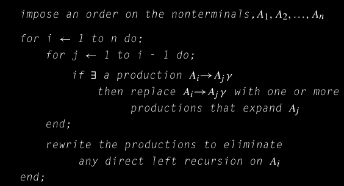

Consideriamo l'invariante del loop esterno per cercare di capire meglio.

All'inizio dell'i-esima iterazione del loop esterno:

∀ k < i, *nessuna produzione che espande Ak ha Al nel suo rhs*, per l < k.

Alla fine di questo processo, *(i = n)*, tutte le ricorsioni sinistre indirette sono state elimiante attraverso il loop interno, e tutte le ricorsioni sinistre dirette sono state eliminate dal loop esterno come ultimo step dell'iterazione.

# Parsing senza backtracking

Il problema dell'inefficienza dei parser leftmost nasce dal loro bisogno di dover fare backtracking. Se il parser espande la parte inferiore dell'albero con la produzioen sbagliato prima o poi inconterà un mismatch tra quella porzione d'albero e le foglie, che corrispondono alle parole ricevute dallo scanner. Quando il parser si accorge del mismatch deve fare annullare tutte le azioni che hanno portato alla costruzione della parte errata di albero e provare altre produzioni. Questo processo spreca risorse e tempo.

Nell'esempio del parser con oracolo, il parser ha scelto le corrette produzioni ad ogni step. Con scelte consistenti, come considerare l'ordine delle produzioni per come compaiono nella grammatica, il parser avrebbe dovuto fare backtracking su ogni *name*, prima provando *Factor ->  ( Expr )* e poi *Factor -> num* prima di derivare *name*. Sarebbe successo anche per l'espansione delle regole 4 e 8, sarebbero state considerate altre alternative prima di espandre con ε.

Per questa grammatica il parser può evitare di fare backtracking con una semplice modifica. Quando il parser selziona la prossima regola, può considerare sia il simbolo di focus che il prossimo simbolo nello stream di input, chiamato *simbolo di lookahead*. 
Usando un solo simbolo di lookahead il parser può scartare tutte le scelte non corrette quando si fa' il parsing di un'espressione di  una grammatica ricorsiva a destra. Pertanto possiamo affermare che la grammatica è baktracking free con un solo simbolo di lookahead. Una grammatica backtrack-free è chiamata anche **grammatica predittiva**.

--------------------------------------------

### Grammatica backtrack-free
Una CFG per cui un parser da sinistra a destra può sempre predirre la corretta produzione da applicare con un lookahead di almeno una parola.

-------------------------------------------

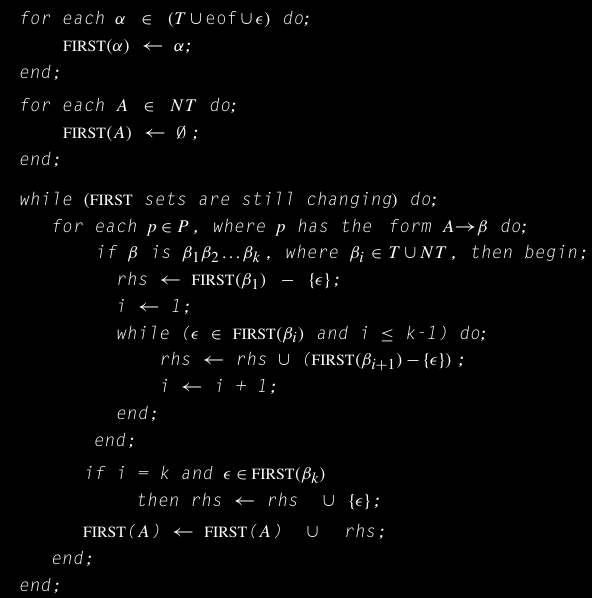

### Insieme FIRST
Per un simbolo α che appartiene alla grammatica, FIRST(α) è l'insieme dei terminali che possono comparire all'inizio di una frase derivata da α.

Possiamo formalizzare la proprietà che rende le espressioni delle grammatiche ricorsive a destra backtrack-free. Ad ogni step durante il parsing la scelta della produzione da applicare è ovvia perché ogni alternativa per il simbolo non terminale più a sinistra porta a un distinto simbolo terminale. Confrontare la prossima parola nello stream di input con quelle scelte permette di utilizzare la corretta regola di espansione.

Per ogni simbolo α della grammatica, definiamo l'insieme FIRST(α) come l'insieme dei simboli terminali che possono comparire come prima parola in una stringa derivata da α. Il dominio di FIRST(α) è l'insieme dei simboli della grammatica, *T ∪ NT ∪ {epsilon, eof}* e il suo range è *T U {epsilon, eof}*. Se  α è un terminale, epsilon, oppure *eof*, allora FIRST(α) ha esattamente un solo elemento, ovvero α. Invece per un simbolo non terminale *A*.

### eof
*eof* viene implicitamente letto alla fine di ogni frase della grammatica, quindi in entrambi i domini e nel range del FIRST.

La figura relatia all'algoritmo per la costruzione dell'insieme FIRST, crea l'insieme FIRST per ogni simbolo della grammatica. Come primo step l'algoritmo setta l'insieme FIRST per i casi più semplici, terminali, epsilon e *eof*. Per la grammatica con espressioni  ricorsive a destra, l' esempio come mostrata precedentemente, come step iniziale produce i seguenti insiemi FIRST:

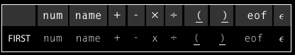

Al passo successivo l'algoritmo itera sulle produzioni, sfruttando gli insiemi FIRST per il right-hand side di una produzione per derivare l'insime FIRST dei non terminali sul suo left-hand side. Questo processo si ferma quando raggiunge un punto di "fisso". Per la nostra grammatica con espressioni ricorsive a destra, l'insime FIRST dei non terminali è:

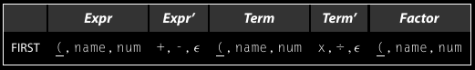

*Expr* ha lo stesso insieme FIRST di *Factor* poiché applicando le regole di derivazione sul simbolo *Expr* arrivo ad ottenere il simbolo non terminale *Factor*.

Cosiì abbiamo deinfito l'insieme FIRST su ogni singolo simbolo della grammatica, ma ci conviene definirlo anche su stringhe di simboli. Per una stringa di simboli, 
*s = β1 β2 β3... βk*, definiamo l'insieme FIRST(*s*) come l'unione degli insiemi FIRST per *β1,β2,...,βn* dove βn è il primo simboli il cui insieme FIRST non contiene epsilon , e *epsilon* ∈ FIRST(s) se e solo se è nell'insieme per ogni βi, 1 <= i <= k. 

Concettualmente, l'insieme FIRST semplifica l'implementazione di un parser Top-Down.

Consideriamo le regole per *Expr'* nella grammatica ricorsiva a destra.

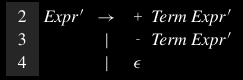

Quando il parser prova ad espandere *Expr'* sfrutta il simbolo di lookahead e l'insieme FIRST per scegliere tra la regola 2, 3 e 4. Con un lookahead di *+* il parser espande utilizzando la regola 2 perché *+* è nell'insieme FIRST(*+ Term Expr') e non nel FIRST(*- Term Expr*) o FIRST(*epsilon*). In maniera similem un lookahead di *-* detta di scegliere la regola 3.

La regola 4, la *epsilon*-produzione ci mette di fronte a un problema più complesso. FIRST(*epsilon*) è semplicemente {*epsilon*}, che non combacia con nessuna parola restituita dallo scanner. Intuitivamente il parser dovrebbe applicare la *epsilon* produzione quando il simbolo di lookahead non è un membro dell'insieme FIRST o di nessun'altra alternativa. 

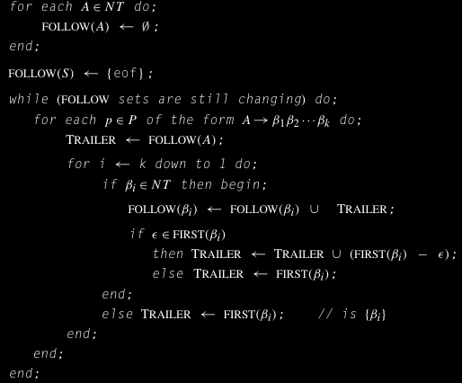

---------------------------------------------------------------------------- 
### FOLLOW set

Per un non terminale α, FOLLOW(α) contiene l'insieme delle parole che possono occorrere immediatamente dopo α in una frase. 

---------------------------------------------------------------------------  

Per differenziare tra input legali ed errori di sintassi il parser deve sapere quali parole posssono apparire come "leading symbol" dopo un valida applicazione della regola 4; ovvero l'insieme di simboli che possono seguire *Expr'*

Per tenere traccia delle informazioni definiamo l'insieme FOLLOW(*Expr'*) per contenere tutte le parole che possono occorrere immediatamente a destra nella stringa derivata da *Expr'*.

L'immagine precedente rappresenta un algoritmo che permette di costruire l'insieme follow per ogni simbolo non terminale, si preusspone l'esistenza degli insiemi FIRST. L'algoritmo inizializza ogni insieme FOLLOW come insieme vuoto per poi iterare sulle produzioni, calcolando le contribuzioni di ogni suffisso parziale per ogni insieme FOLLOW di ogni simbolo presente nel lato destro. L'algoritmo si ferma quando raggiunge un punto fisso. Per le grammatiche con espressioni ricorsive a destra l'algoritmo produce:

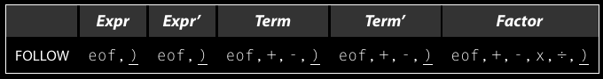

Il parser può usare FOLLOW(*Expr'*) quando prova ad espandere un non terminale *Expr'*. Se il simbolo di lookahead è un *+*, applica la regola 2, se dovesse essere un *-* allora applica la regola 3. Se il simbolo di lookahead è nell'insieme FOLLOW(*Expr'*), che contiene *eof* e *)*, allora applica la regola 4. Qualsiasi altro simbolo genera un syntax error.

Usando gli insiemi FIRST e FOLLOW, possiamo specificare più precisamente le condizioni che rendono una grammatica backtrack-free per un parser top-down.
Per una produzione *A → β*, definiamo un "miglioramento" dell'insieme FIRST, FIRST+. (*n.d.r il + dopo varie parole per esempio, FIRST+ o ->+ e da intendersi come esponente, quindi 1 o più occorrenze* )

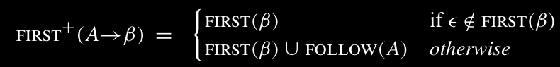

Una grammatica backtrack-free ha la proprietà che per ogni non terminale *A* con più right-hand side, *A →β1 | β2 |···| βn*.

*FIRST+ (A→βi) ∩ FIRST+ (A→βj) = ∅, ∀ 1 ≤ i, j ≤ n, i != j.*

Una qualunque grammatica che ha questa proprietà è una grammatica *backtrack-free.*

Per la grammatica con espressioni ricorsive a destra, solo le produzioni 4 e 8 hanno insiemi FIRST+ che sono diversi dai loro insiemi FIRST.

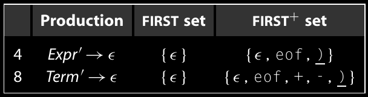

Applicando la condizione di backtrack-free coppia per coppia di ogni insieme di alternative sul lato destro, si dimostra che effettivamente la grammatica è backtrack-free.

## Left-Factoring per eliminare il backtracking

Non tutte le grammatiche sono backtrack-free. Un esempio di queste grammatiche è, consideriamo di estendere la grammatica delle espressioni per includere anche chiamate a funzione, denotando con parentesi *( )*, e riferimenti ad elementi di array con parentesi quadre *[ ]*. Per aggiungere queste opzioni dobbiamo rimpiazzare la produzione 11, *Factor -> name*, con un insieme di tre regole, piu un insieme di regole ricorsive a destra per le liste degli argomenti.

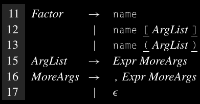

*Un lookahead di 2 parole è sufficiente per gestire questo caso specifico. Ma per un qualunque numero finito di lookahead possiamo ideare una grammatica dove quell'lookahead non è sufficiente.*

Visto che le produzioni 11, 12 e 13 iniziano tutte per *name*, hanno lo stesso insieme FIRST+. Quando il parser prova ad espandere un istanza di *Factor* con un lookahead uguale a *name*, non ha una criterio per scegliere la produzione 11, 12 e 13. Chi crea il compilatore può implementare un parser che sceglie una regola e fa' backtracking quando la scelta è errata. Oppure in alternativa possiamo trasformare queste produzioni per creare insiemi FIRST+ disgiunti.

La seguente riscrittura delle produzioni 11, 12 e 13 permette di descrivere lo stesso linguaggio ma produce degli insiemi FIRST+ disgiunti.

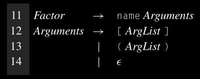

### Left factoring 
*Processo che permette di isolare ed estrapolare prefissi comuni in un insieme di produzioni.*

Questa riscrittura rompe la derivazione di *Factor* in due step. Il primo step fa corrispondere il prefisso comune delle regole 11, 12 e 13. Il secondo step riconosce i 3 distinti suffissi: *[Expr], (Expr)* ed * ε. La riscrittura aggiunge un nuovo non terminale, *Arguments* e sposta i suffisi per *Factor* sul lato destro di *Arguments*. Questa trasformazione viene chiamata **LEFT FACTORING**.

**N.D.R: TEORICAMENTE FINIREBBE QUI, DA CONFRONTARE CON LE SLIDE FATTE A LEZIONE**

# Parser Top-Down a discesa ricorsiva

Le grammatiche backtrack-free si prestano  per parsing semplice ed efficiente sfruttando un paradigma chiaamto discesa ricorsiva.

Un parser a discesa ricorsiva è strutturano come un insieme di procedure mutuamente ricorsive, una per ogni non terminale della grammatica.
La procedura corrispodente a un non terminale *A* permette di  riconsidera un istanza di *A* nello stream di input. Per riconoscere un non terminale *B* sul lato destro di *A*, il parser invoca la procedura corrispondente al simbolo *B*. Pertanto la grammatica serve a "guidare" l'implementazione del parser.

Consideriamo le tre regole di *Expr'* nella grammatica ricorsiva a destra delle espressioni:

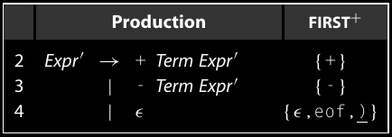

Per riconoscere le istanze di *Expr'*, dobbiamo creare una routine *EPrime()*. Scegliamo tra le 3 regole, o un eventuale syntax error, basandoci sugli insiemi FIRST+ dei loro lati destri. Per ogni lato destro il codice testa la presenza di altri simboli.

Per testare la presenza di un non terminale, ipotizziamo *A*, il codice invoca la procedura corrispodente ad *A*. Per testare un simbolo terminale, come *name*, viene eseguita una comparazione diretta, nel caso in cui avesse successo si avanza nell'input stream chiamando lo scanner, *NextWord()*. Se si ritrova a fare matching di una ε-produzione, il codice non chiama *NextWord()*.

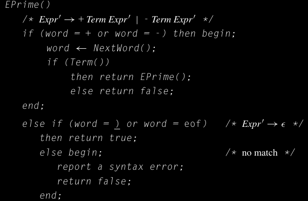

La strategia per costruire un parser ricorsivo discedente è:
Per ogni non terminale, costruiamo una procedura per riconoscere le sua alternative sul lato destro. Queste procedure si chiamano tra di loro per riconoscere i non terminali.
I simboli terminali vengono riconosciuti tramite matching diretto.
Nell'immagine sotto viene riportato un parser top-down con ricorsione discedente per la versione ricorsiva destra della grammatica delle espressioni che abbiamo visto negli esempi precedenti.
Per una grammatica "piccola", chi crea il compilatore può costruire velocemente un parser ricorsivo discedente. Con un po' di attenzione un parser ricorsivo discedente può produrre precisi messaggi di errore. Il momento migliore per generare quei messaggi è quando il parser fallisce nel trovare un simbolo terminale atteso; per esempio dentro *EPrime, TPrime* esempio *Factor*.

# Parser LL(1) table-driven

Seguendo i principi degli insiemi FIRST+, possiamo generare automaticamente parser top-down per grammatiche backtrack-free. Lo strumento permette di costruire gli insiemi FIRST, FOLLOW e FIRST+. Gli insiemi FIRST+ dettano le decisioni di parsing, affinché lo strumento possa creare un parser top-down efficiente. Il parser che viene creato  è chiamato parser LL(1).

Il nome LL(1) deriva dal fatto che questi parser leggono l'input da SINISTRA verso DESTRA, e costruiscono una derivazione a sinistra, usando UN SIMBOLO di lookahead.

Le grammatiche che lavorarno con uno schema LL(1) vengono chiamate *grammatiche LL(1)*, e per definizione sono backtrack-free.

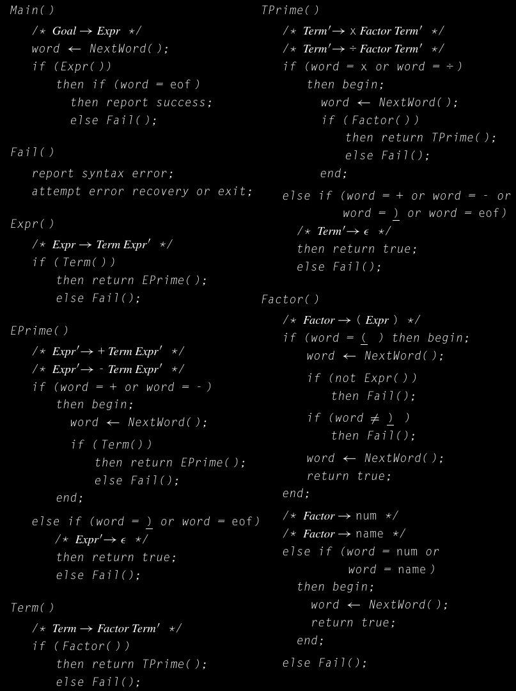

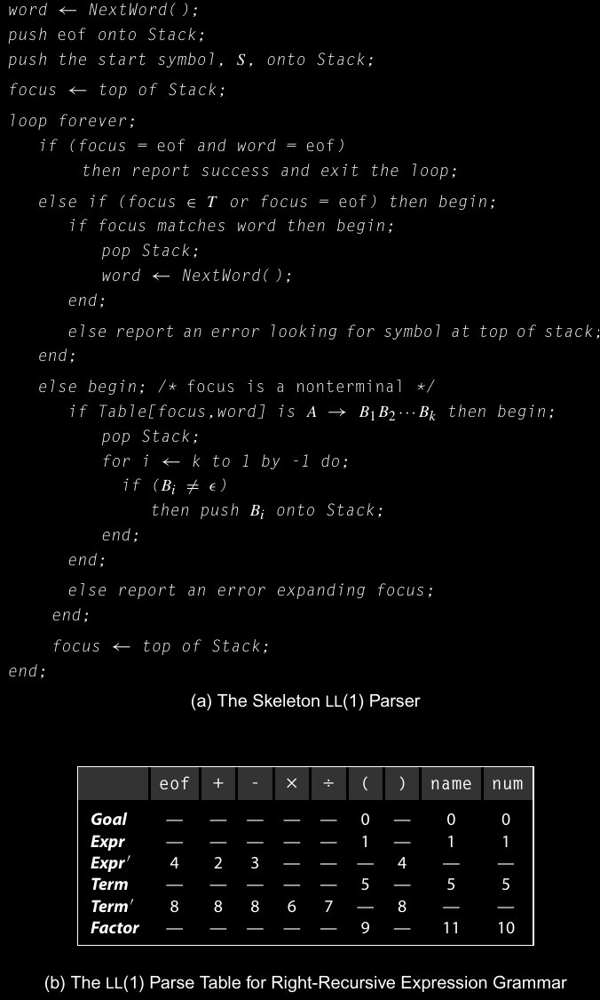

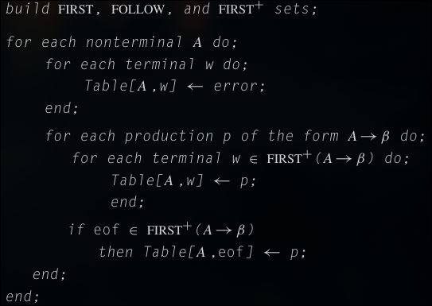

Per costruire un parser LL(1), chi crea il compilatore scrive una grammatica ricorsiva a destra e backtrack-free e un *generatore di parser* costruisce il parser effettivo. Il modo più comune per implementare parser LL(1) è un approccio table-driven con un parser "scheletro", come nelle immagini precedenti. Il generatore di parser costruisce la tabella *Table*, che codifica le decisioni del parser e guida il parser scheletro.

Nel parser scheletro la variabile *focus* tiene traccia del prossimo simbolo che deve combaciare sulla parte di albero parziale che viene costruito sulla frontiera inferiore. La tabella di parsing, *Table*, mappa coppie di non terminali e simboli di lookahead (terminali o *eof*) in delle produzioni. Dato un non terminale *A* e un simbolo lookahead *w*, *Table[A, w]* specifica la corretta espansione.

L'algoritmo per costruire *Table* è semplice. Si assume che gli insiemi FIRST, FOLLOW e FIRST+ sono disponibili per la grammatica. Itera sui simboli della grammatica e popola la tabella. Se la grammatica rispetta le condizioni di backtrack-free, allora la costruzione produce una tabella corretta in un tempo *O(|P| * |T|)*, Dove P è l'insieme delle produzioni della grammatica mentre T è l'insieme dei terminali.

Se la grammatica non è backtrack-free, allora durante la costruzione della tabella assegnerà più di una produzione ad alcuni elementi di *Table*.

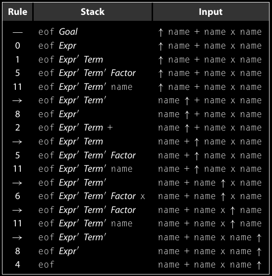

Se la costruzione assegna a *Table[A, w]* più volte, allora due o più alterantive sul lato destro per A hanno *w* nel loro insieme FIRST+, violando la condizione di backtrack-free. Il generatore di parser può accorgersi di questa situazione con dei semplici test su i due assegnamenti alla tabella *Table*.

Per esempio nell'immagine che mostra le azioni prese dal parser LL(1) per l'esporessione in input *a + b * c*.
La colonna centrale mostra il contenuto dello stack del parser, che contiene la parte infieriore dell'albero parzialmente completa. L'operazione di parsing si conclude con successo quando esegue il pop di *Expr'* dallo stack, lasciando *eof* in cima allo stack come prossimo simbolo nello stream di input.

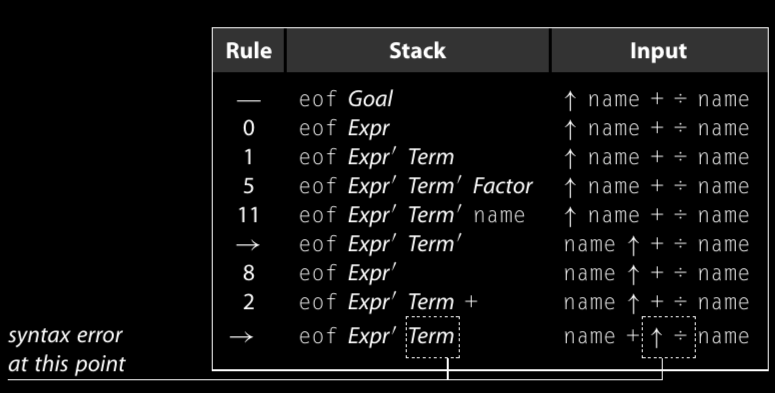

Consideriamo l'esempio riportato qui sopra, il parser riscontra un errore di sinstassi quando cerca di espandere il non terminale *Term* con un simbolo lookahead *÷*. *Table[Term, ÷]* contiene "---", indicando un errore di sintassi.

In alternativa, un generatore di parser LL(1) può generare un parser direttamente codificato, ovvero invece di sfruttare una tabella si usano direttamente dei confronti. Il generatore di parser quindi costruirà gli insiemi FIRST, FOLLOW e FIRST+. Poi itera sulla grammatica seguendo il principio dell'algoritmo per costruire la tabella di parsing, ma invece di creare una tabella genera direttamente, per ogni non terminale, delle procedure per riconoscere ogni possibile right-hand side per quel non terminale. Questo processo è guidato dagli insiemi FIRST+. Il parser avrà la stessa velcoità e gli stessi vantaggi di località (memoria) che si ottengono con gli scanner codificati direttamente e dei parser discendenti ricorsivamente, mantenedo i vantaggi dei sistemi generati da grammatiche, in una specifica pìu ad alto livello e con un'implementazione più semplice.
