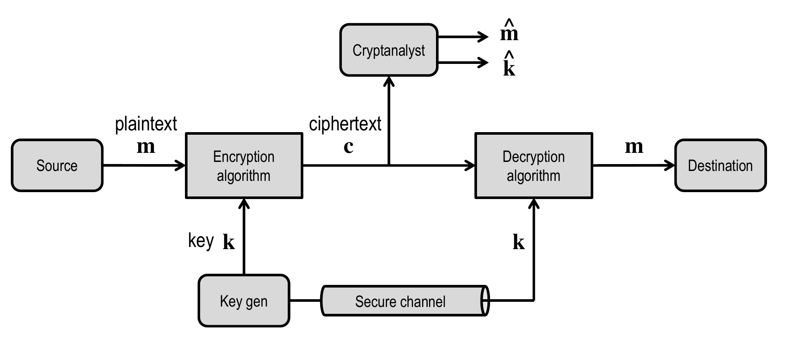
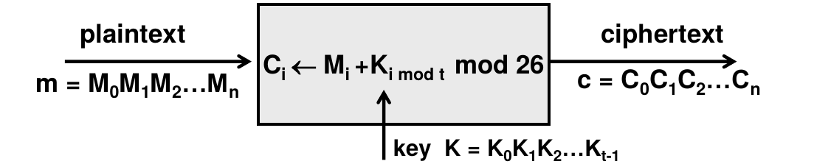

# Cryptography

It is the study of mathematical techiniques related to information and communication
security in the precese of third party adversaries.

Cryptography can be used for:

- Confindentiality
- Data integrity
- Authentication
- Non-repudiation

# Cryptographic algorithm

Symmetric cryptography:
It is called symmetric since the sender and the receiver share the same secret key

All classical encryption algorithm are symmetric until the 1970.

It is generally used for protecting some data stored in a repository or sent to a remote
entity.

Designed to take a reasonable-length key (eg. 128 bits) and generatin a one-to-one
mapping from clear text to cipher text that "looks" random to entities that do not
know the key.

## Symmetric Cipher Model

## Definitions:

**Cipher**: algorithm for transforming plain text into cipher text

*Two functions*:

- **Encryption (enciphering)**: It converts the plain text m (original message)
    to cipher text c; it uses a secret key k (known only to sender and receiver)
    **c = E(m, k) = Ek(m)**
    The function can be either deterministic or randomic

- **Decryption (deciphering)**: Recovers the original message m from the cipher text c
    **m = D(k, c) = Dk(c) = Dk(Ek(m))**

    This function is deterministic

- Assume that encryption and decryption algorithms are known
- Implies a secure channel is used for distributing the key
- Some example of common algorithm: DES, 3DES, AES, ChaCha20

In theory the security of a cipher might rest in the secrecy of a secret
encryption algorithm: c = E(m); m = D(c)

However, whenever a user leaves a private group, the algorithm must change or
other people may find out which algorithm is being used.

In practice the encryption algorithm are not secret and rely on the secrecy of the key.
If an authorized participant joins or leaves the group then we can change the key from a
large set (keyspace), in example: a 256 bit number gives 10^77 values we can chose from.

As Kerckhoffs’ principle says: The security should be based on the secrecy of the key
and not in the details of the algorithm.

# Classical encryption techniques

## Substitution ciphers

Substitution is a classical encryption technique, the symbols (like letters)
of plaintext are replaced by other symbols following a specific mapping.

If we view the plaintext as a sequence of bits, then every block of bits in the
plaintext *m*, will be replaced by the corresponding bit block of the ciphertext.

Some examples of substitution ciphers:

- Monoalphabetic substitution with shift (Caesar cipher)
- Monoalphabetic substitution (monoalphabetic cipher)
- Polialphabetic substitution (polialphabetic cipher)

### Caesar Cipher

It's the earliest substitution cipher that is known to us, it was invented by
Julius Caeser and was used for military affairs.

It replaces each letter with the 3rd letter on

**Example**:

meet me after the toga party  
PHHW PH DIWHU WKH WRJD SDUWB  

We can define substitution as:  

a b c d e f g h i j k l m n o p q r s t u v w x y z  
D E F G H I J K L M N O P Q R S T U V W X Y Z A B C

Mathematically give each letter a number:  

a b c d e f g h i j k l m n o p q r s t u v w x y z  
0 1 2 3 4 5 6 7 8 9 10 11 12 13 14 15 16 17 18 19 20 21 22 23 24 25

Then we can have the Caeser cipher as:  

C = E(M) = (M + k) mod 26, with k = 3  
M = D(C) = (C - k) mod 26, with k = 3  

We can have 26 possible ciphers, given by the number of shift that we can do with 
the letters of the alphabet.  
If the mapping of one letter is discovered then the entire transformation is found.

Starting with the cipher text, we can easily brute force it in order to find
the substitution an the plain text.

### Monoalphabetic Substitution Ciphers

Rather than just shifting the alphabet we could shuffle the letters arbitrarily.
Each plaintext letter maps to a different random ciphertext letter.

Example:  

abcdefghijklmnopqrstuvwxyz  
DKVQFIBJWPESCXHTMYAUOLRGZN  

*plain text*: ifwewishtoreplaceletters  
*cipher text*: WIRFRWAJUHYFTSDVFSFUUFYA  

The secret substitution can be seen as the secret key.
With this method we now have a total of 26! = 4*10²⁶ keys.

We might think this is secure, but in reality we neet to look for the 
text frequency and the correlation.

The main problem with monoalphabetic substitutions is text redundancy, we have 
non uniform frequency distributions and correlations.

In case of human languages, some letters are more common than others, or  
some letters most of the time follow each other.

### Polyalphabetic substitution chipers

An approach to improve security is to use polyalphabetic substitution ciphers.  
It uses a set of monoalphabetic substitutions.  

Defines a rule to determine which cipher alphabet should be used at each step.  
It normally uses a key to select which substitution is used for each letter of the message.  

### Vigenère Cipher

It's the simplest polyalphabetic substitution cipher.

The key is multiple letters long:  
- i_th letter specifies the i_th alphabet to use
- use each alphabet in turn

It is effectively multiple Caesar ciphers: K = K0 K1 K2 ... Kt-1

Decryption works in reverse  

Polyalphabetic ciphers make crpytoanalysis hader, having multiple ciphertext letters 
for each plaintext letter flattens the frequency distribution.  

But one weakness is the repeating nature of the key:
- Need to determie number of alphabets (key length)
- Start with letter frequencies
- Then can attack each (they are like shift ciphers and can be broken individually)

### Transposition ciphers

Transposition is another classical encryption techinque.  

- It hides the message by rearranging the letter order (block of bits)
- Without altering the actual letter used
- Performs a sort of permutation

Can recognize these since have the same frequency distribution as original text

**Example**: Write letters of message out in rows over a specified number of columns
The reorder the columns according to some key before reading off the rows

Key:            4 3 1 2 5 6 7
Plain text:     a t t a c k p
                o s t p o n e
                d u n t i l t
                w o a m x y z

Ciphertext: TTNAAPTMTSUOAODWCOIXKNLYPETZ

### Product ciphers

Ciphers using substitutions or transpositions may be not sufficiently secure.
Hence consider using several cipher in succession to make it harder to break the cipher.

- Two substitution make a more complex substitution
- Two transposition make a more complex transposition
- A substitution followed by a transposition make a new much harder cipher

This a bridge from classical to modern ciphers

# Perfect secrecy

### Shannon's model of a cryptosystem

A secrecy system consists of: 
- A message space *M*
- A key space *K*
- A cipher text space *C*
- Two functions:
    - Enc: K x M -> C
    - Dec: K x C -> M

The two functions define two sets of transformations Ek and Dk indexed by keys k ∈ K  
- Encryption transformations Ek: M -> C
- Decryption transformations Dk: C -> M

Correctness condition:  
Dk (Ek (m)) = m  

Two secrecy system will be the same if they consist in the same set of transformation Ek

Shannon distinguishes between:
- **Practical Secrecy**: Breaking the system requires infeasible effort
- **Theoretical secrecy**:
    - Impossible to break the system, even with unlimited time and manpower available.
    - The ciphertext provides no information about the plaintext

--> continua da slide 31